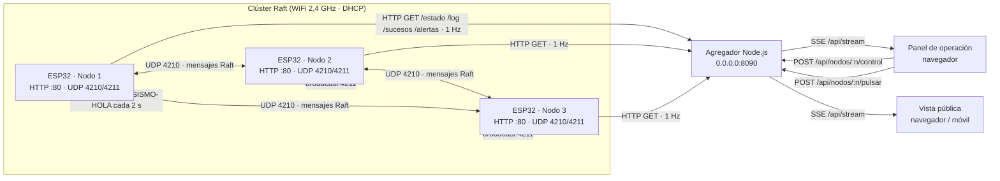
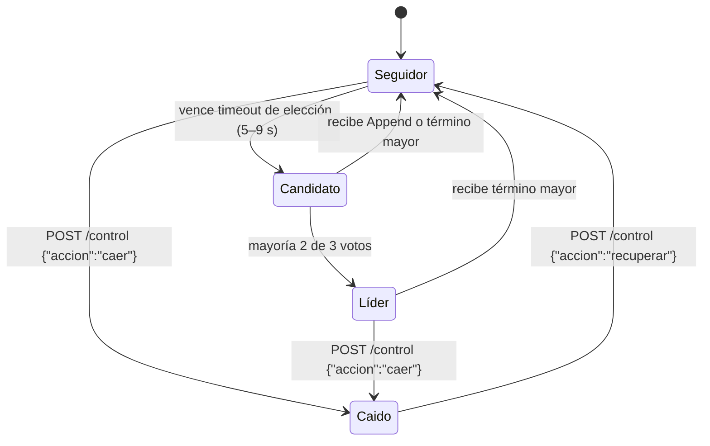
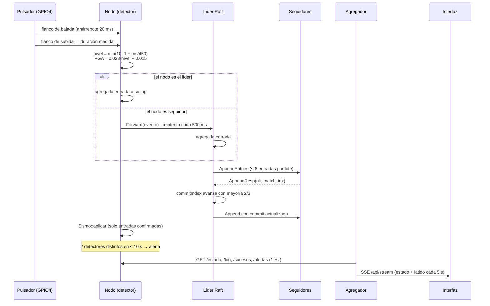

# Alerta Sísmica — clúster de detección sísmica simulada sobre ESP32 con consenso Raft

Sistema distribuido de **tres nodos ESP32** que forman un clúster con **consenso Raft** propio,
comunicado por WiFi, más un **agregador Node.js** que sondea su estado y sirve dos interfaces web:
un panel de operación y una vista pública de alertas.

> **Los eventos sísmicos son simulados.** La entrada es un **pulsador físico** en cada placa; no hay
> instrumentación sísmica ni medición de aceleración. La duración de la pulsación se traduce en un
> nivel de intensidad (1–10) y un PGA según una escala de simulación. El proyecto demuestra
> **procesamiento distribuido, comunicación entre procesos y consenso**, no medición sismológica.

**Versión:** `v1.0.0-rc1` · **Licencia:** MIT · **Estado:** software validado; campaña física en curso
(ver [Estado actual](#estado-actual-del-proyecto)).

---

## 1. Problema que resuelve

Una red de alerta temprana necesita varios puntos de observación que **coincidan** para no dar falsas
alarmas, y debe seguir funcionando si uno de esos puntos falla. Una solución centralizada depende de
un único servidor.

Este proyecto implementa el núcleo de ese problema con **consenso replicado**: los eventos se
proponen a un clúster de tres nodos, se replican en un log común y solo se consideran confirmados
cuando una **mayoría (2 de 3)** los acepta. Un evento confirmado alimenta una máquina de estados
determinista que emite una alerta cuando **dos detectores distintos** coinciden en una ventana de
**10 segundos**.

---

## 2. Arquitectura distribuida



- **No hay base de datos:** el log de Raft vive en RAM de cada nodo; solo `currentTerm` y `votedFor`
  se persisten en NVS. El agregador mantiene una foto agregada en memoria.
- **No hay microservicios ni nube:** firmware embebido + un agregador monolítico + navegador.

---

## 3. Los tres nodos ESP32

Cada placa ejecuta el mismo firmware compilado con un número distinto (`-DNODO=1|2|3`), que determina
su identidad:

| Elemento | Implementación |
|---|---|
| Hardware | ESP32 DevKit V1 (30 pines, CP2102) |
| Entrada de eventos | **Pulsador en GPIO4 (D4) a GND**, `INPUT_PULLUP`, antirrebote 20 ms, mínimo 80 ms |
| Indicador | LED azul en GPIO2 (fijo = conoce líder; 1 Hz = sin líder; rápido = pulsando) |
| Identidad | `NODO` en tiempo de compilación → hostname `sismo-nodo-N`, AP `SISMO-D<N>-config`, id `nodo-N-…` |
| API | HTTP 80: `/`, `/estado`, `/log`, `/sucesos`, `/alertas`, `POST /control`, `POST /pulsar`, `POST /huella` |
| Persistencia | NVS (`Preferences`): término y voto (`raft`), credenciales WiFi (`wifi`), huella (`ubic`) |
| Configuración WiFi | Portal cautivo propio si no conecta, si se pulsa EN dos veces o si se mantiene el botón al encender |
| Actualización | OTA (ArduinoOTA, puerto 3232 UDP; el PC recibe la conexión en 32323 TCP) |



### Activación de eventos mediante pulsador (simulación)



**Regla de alerta:** evento disparador + el evento más cercano **libre** de cada **otro** detector
dentro de una ventana de 10 s; el promedio de niveles decide la severidad (≥ 7,5 alta, ≥ 4,5 media,
resto baja). Los eventos usados en una alerta no se reutilizan.

---

## 4. Consenso Raft implementado

Implementación propia en C++ (`firmware/detector/src/nucleo/`), aislada de Arduino y probada en el PC.

| Componente | Estado |
|---|---|
| Elección de líder, términos y voto único persistido | Implementado |
| Regla “log al día” y chequeo de consistencia (`prev_idx`/`prev_term`) | Implementado |
| `AppendEntries`/heartbeat (500 ms), replicación en lotes (≤ 8, ≤ 4 en vuelo) | Implementado |
| `commitIndex` por mayoría 2/3, solo entradas del término actual | Implementado |
| *Forward* de eventos desde seguidores al líder, con deduplicación por `id` | Implementado |
| Recuperación de un nodo reiniciado (*catch-up* desde el índice 1) | Implementado |
| Reintentos, timeouts, caída simulada y recuperación | Implementado |
| Log durable (persistencia del log), snapshots, cambio de membresía | **No implementado** (limitación) |
| Pre-vote, check-quorum, autenticación/cifrado de mensajes | **No implementado** (limitación) |

---

## 5. Comunicación entre componentes

| Canal | Protocolo | Puerto | Formato | Quién |
|---|---|---|---|---|
| Consenso Raft | UDP unicast | **4210** | JSON compacto (claves de 1–2 letras) | Nodo ↔ Nodo |
| Descubrimiento | UDP broadcast `SISMO-HOLA:N` cada 2 s | **4211** | texto | Nodo ↔ Nodo |
| API del nodo | HTTP | **80** | JSON | Agregador → Nodo |
| Panel | HTTP + SSE | **8090** | JSON / `text/event-stream` | Navegador ↔ Agregador |
| OTA | UDP 3232 + TCP 32323 | — | espota | PC ↔ Nodo |
| Portal cautivo | AP + DNS + HTTP | 53/udp, 80/tcp | HTML | Móvil ↔ Nodo |

Mensajes Raft (6 tipos): `VoteReq`, `VoteResp`, `Append`, `AppendResp`, `Forward`, `ForwardAck`.

---

## 6. Backend y agregador

`web/` es un proceso **Node.js sin dependencias** (solo módulos nativos):

| Archivo | Responsabilidad |
|---|---|
| `server.js` | HTTP: estáticos, `/api/estado`, SSE `/api/stream`, proxy de control |
| `poller.js` | Sondeo 1 Hz de los nodos, foto agregada, líder y quórum |
| `config.js` | `NODOS`, `PUERTO` (8090), posiciones fijas de los detectores |
| `public/` | Panel de operación (6 pestañas) y vista pública |
| `fake/` | Nodos simulados para demos sin hardware (**no implementan Raft**) |

Endpoints propios: `GET /api/estado`, `GET /api/stream`, `POST /api/nodos/:n/control`,
`POST /api/nodos/:n/pulsar` (exige `Content-Type: application/json`).

---

## 7. Interfaces de monitorización

| Vista | Ruta | Contenido |
|---|---|---|
| Panel de operación | `http://<PC>:8090/` | Panorama, sismógrafos, clúster Raft, detectores, alertas, registros (con exportación CSV) |
| Vista pública | `http://<PC>:8090/publico` | Estado del servicio, último sismo, historial, guía de actuación, ajustes |

Las vistas usan **SSE** para el estado en tiempo real y un **mapa SVG propio** (sin Leaflet ni teselas
externas). La única dependencia externa de la interfaz es la tipografía Inter desde Google Fonts.

---

## 8. Tecnologías

| Capa | Tecnología |
|---|---|
| Nodos | ESP32, C++17, Arduino core ESP32 3.3.12 |
| Consenso | Raft propio (elección, replicación, commit, forward) |
| Transporte | UDP 4210/4211, HTTP 80 |
| Configuración | NVS (`Preferences`), portal cautivo, DHCP + mDNS |
| Agregador | Node.js ≥ 22, ESM, **sin dependencias**, SSE |
| Interfaz | HTML/CSS/JS nativo, SVG propio |
| Pruebas | C++ (harness propio + red Raft simulada), Node `node:test` |
| Contenedores | Docker Compose (Fedora, openSUSE Leap, Ubuntu, Alpine) |

---

## 9. Requisitos

- **Hardware:** 3 × ESP32 DevKit V1, 3 cables USB de datos, 3 pulsadores, protoboard y cables.
- **Red:** WiFi **2,4 GHz** con **DHCP**, broadcast permitido y **sin aislamiento de clientes**.
  Internet recomendable para NTP (sin hora no se forman alertas).
- **PC:** Linux; `g++` ≥ C++17, `make`, Node ≥ 22, `arduino-cli` con el core `esp32:esp32` 3.3.12 y
  ArduinoJson 7.x. Docker (opcional) para la demo sin hardware.

---

## 10. Instalación y configuración

```bash
git clone <url-del-repositorio>
cd "detector de sismos en red distribuida"

# Secretos del firmware (NO se versionan)
cd firmware/detector
cp secretos.ejemplo.h secretos.h
# editar WIFI_PASS, OTA_CLAVE y PORTAL_CLAVE (mínimo 8 caracteres)

# Red: el SSID se define en config.h
#   #define WIFI_SSID "TU_RED_2_4GHZ"
```

`secretos.h` está en `.gitignore`. La clave del AP del portal **no** se imprime por el puerto serie.

---

## 11. Compilación y flasheo

```bash
cd firmware
./cargar.sh 1          # compila con -DNODO=1 y flashea por USB
./cargar.sh 2
./cargar.sh 3
```

Equivalente sin flashear:

```bash
arduino-cli compile --fqbn esp32:esp32:esp32 \
  --build-property "compiler.cpp.extra_flags=-DNODO=1" \
  --build-path /tmp/fw1 firmware/detector
```

Tamaño de referencia (core 3.3.12): `detector.ino.bin` ≈ 1.106.048 B. Procedimiento de campaña física
detallado en [`docs/prueba-hardware.md`](docs/prueba-hardware.md) y
[`entrega/06-manual/conexion-esp32.md`](entrega/06-manual/conexion-esp32.md).

---

## 12. Ejecución

```bash
# Panel (sin instalar dependencias)
cd web
npm start
# Panel:        http://localhost:8090/
# Vista pública: http://<IP-del-PC>:8090/publico

# Si mDNS no resuelve las placas
NODOS="http://IP1,http://IP2,http://IP3" npm start
```

Demo sin hardware (nodos simulados; **no** ejecutan Raft):

```bash
cd web
npm run fake     # 3 nodos falsos en 9001–9003
NODOS="http://127.0.0.1:9001,http://127.0.0.1:9002,http://127.0.0.1:9003" npm start
```

Despliegue con contenedores (3 sistemas operativos + panel):

```bash
docker compose up --build        # panel en http://localhost:8095/
docker compose down
```

---

## 13. Pruebas

```bash
# Núcleo en C++ (sin hardware): 78 casos, red Raft simulada
cp -a firmware/test /tmp/val-test && cp -a firmware/detector/src /tmp/val-src
cd /tmp/val-test && make JSON_DIR="$HOME/Arduino/libraries/ArduinoJson/src" test

# Arnés de configuración desplegada (500 ms / 5000–9000 ms)
# ver entrega/05-pruebas/scripts/ y entrega/10-informes-fase3/

# JavaScript (sin dependencias, solo loopback): 41 pruebas
cd web && node --test --test-concurrency=1 test/*.test.js
```

Herramientas de campaña física en `entrega/05-pruebas/scripts/` (snapshots validados, sondeo con
tiempos por consulta, capturas verificadas y captura pasiva del serial por `usbmon` sin abrir el tty).

---

## 14. Estructura del repositorio

```
.
├── firmware/                 Firmware de los nodos
│   ├── detector/             Código Arduino + núcleo portable (src/nucleo/)
│   ├── test/                 Suite C++ con red Raft simulada
│   ├── cargar.sh             Compilación y flasheo (USB / OTA)
│   ├── quien.sh              Identificación de placas por MAC
│   └── placas.conf           Registro MAC → número de detector
├── web/                      Backend (Node.js) + interfaces web
│   ├── server.js, poller.js, config.js
│   ├── public/               Panel de operación y vista pública
│   ├── fake/                 Nodos simulados para demo
│   └── test/                 Suite Node
├── docs/
│   ├── prueba-hardware.md    Campaña física con las tres placas
│   └── superpowers/          Diseño y planes históricos (no vigentes)
├── entrega/                  Entregables académicos y evidencias
│   ├── 04-evidencias/        Capturas, logs y tablas por categoría (saneadas)
│   ├── 05-pruebas/           Datos, registros y scripts de campaña
│   └── 10-informes-fase3/    Informes técnicos y diagnósticos
├── mockup/, preview/, new interfaz/, interfaz_*.png
│                             Material de diseño histórico (no es la aplicación)
├── docker-compose.yml        Demo con tres sistemas operativos
├── LICENSE                   MIT
├── THIRD-PARTY.md            Licencias de dependencias
└── README.md
```

---

## 15. Estado actual del proyecto

| Área | Estado |
|---|---|
| Clúster de tres nodos | **Operativo**: 3/3 en red, un único líder, término y log coherentes, quórum completo |
| Firmware `v1.0.0-rc1` | Flasheado en las tres placas; identidades 1, 2 y 3 verificadas |
| Pruebas automáticas | 78/78 C++ · 5/5 arnés de configuración desplegada · 41/41 JavaScript |
| Docker | 4 servicios, 3 nodos *healthy* sobre Fedora 42, openSUSE Leap y Ubuntu 24.04 |
| P0 (preparación de campaña) | **Completado** con evidencias |
| **T1 (evento con pulsador)** | **No aprobada.** Se ejecutó una pulsación: el sistema replicó y confirmó correctamente, pero el pulsador registró **dos eventos cortos** (301 ms y 174 ms, separados 3,2 s) en lugar de uno de ~900 ms. Se documentó la incidencia y se realizó el diagnóstico; la repetición queda pendiente de revisión del contactor. |
| T2 en adelante | Pendientes de autorización |

### Incidencia abierta de T1

- Los dos eventos tienen ids distintos y **idénticos en los tres nodos**; `log_len`/`commit_index`
  pasaron de 1 a 3; no se creó alerta (correcto: un solo detector).
- El `nivel` y el `pga` calculados por el firmware coinciden con la fórmula para las duraciones
  medidas: el cálculo es correcto; la anomalía está en la **entrada física**.
- Diagnóstico y plan de corrección en
  [`entrega/10-informes-fase3/diagnostico-pulsador.md`](entrega/10-informes-fase3/diagnostico-pulsador.md).

---

## 16. Limitaciones conocidas

1. **El evento es simulado** con un pulsador; no hay medición sísmica.
2. **El log no es durable:** vive en RAM. Un reinicio reconstruye desde el líder; un corte de energía
   puede perder eventos aceptados pero no confirmados.
3. **Resincronización de emergencia:** si una mayoría reinicia en frío, un nodo puede descartar su log
   y copiarlo del líder. Es deliberado (para no quedar divergente), pero no garantiza durabilidad.
4. **Sin snapshots:** tope de 1000 entradas; al llenarse se rechazan eventos nuevos.
5. **Sin seguridad de transporte:** API HTTP y UDP Raft sin autenticación ni cifrado; CORS `*`.
6. **Sin pre-vote ni check-quorum:** un líder aislado sigue creyéndose líder.
7. **`ForwardAck` al aceptar**, no al confirmar: un evento puede perderse si el líder muere justo
   después.
8. El “quórum” del agregador es una **inferencia** (≥ 2 nodos disponibles que reconocen al mismo
   líder), no validación de consenso.
9. La **demo Docker no ejecuta Raft**: demuestra portabilidad del contrato y del empaquetado sobre
   tres sistemas operativos.

---

## 17. Privacidad y datos

- **No se versionan secretos:** `secretos.h` (contraseña WiFi, clave OTA y clave del portal) está en
  `.gitignore` y nunca se ha publicado.
- Las **evidencias** de `entrega/` incluyen identificadores de red **saneados**
  (`[MAC-N1]`, `[IP-N2]`, `[SSID]`, …); los resultados de las pruebas no se alteraron.
  Véase [`entrega/05-pruebas/datos/NOTA-saneado.md`](entrega/05-pruebas/datos/NOTA-saneado.md).
- Se excluyen del repositorio los volcados crudos de USB (`*.raw`), PID y archivos `.env`.
- Los archivos funcionales (`config.h` con el SSID, `placas.conf` con las MAC) se conservan para no
  romper el firmware ni los scripts; el repositorio está previsto como **privado**.

---

## 18. Licencia

Código y documentación originales bajo **MIT** — © 2026 Sebastián Revelo. Véase
[`LICENSE`](LICENSE). Las dependencias de terceros conservan sus licencias y **no** se distribuyen
con el repositorio: véase [`THIRD-PARTY.md`](THIRD-PARTY.md).
