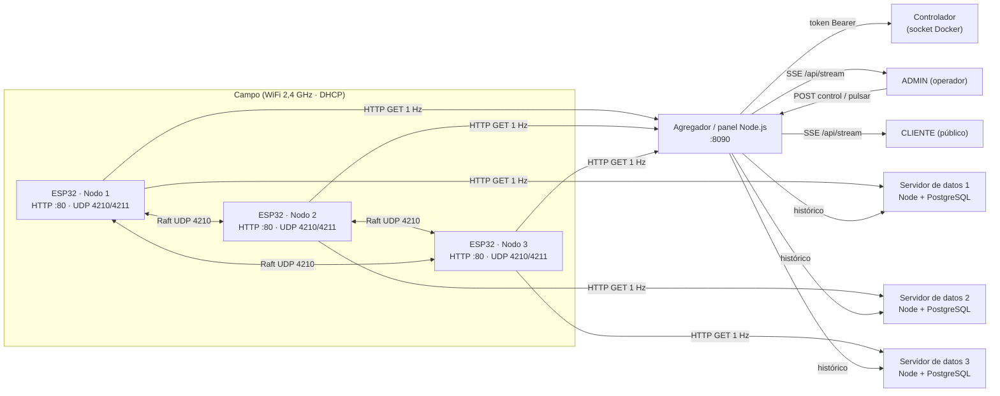

# Arquitectura actual — Alerta Sísmica (VYBRA)

**Qué es este documento.** Inventario técnico verificado del sistema **tal como está hoy en el repositorio**, para decidir qué tecnologías nuevas se pueden añadir y dónde encajan. No es una guía de instalación (eso está en el `README.md`) ni una propuesta de diseño: es una foto del estado real, incluidas las diferencias entre lo que dice la documentación y lo que hace el código.

| Dato | Valor verificado |
|---|---|
| Repositorio | `main`, HEAD `0ee5ed4` (2026-11-18) |
| Versión declarada | `1.0.0-rc1` (el tag `v1.0.0-rc1` está **49 commits por detrás** del HEAD, ver §8) |
| Licencia | MIT |
| Estado | Software validado por pruebas; campaña física en curso. El ensayo **T1 no está aprobado** (incidente del pulsador, §9.4) |
| Tamaño del repo | 102 commits · 279 archivos rastreados · `.git` 11 MB |
| Verificación | Inspección de código con referencias `archivo:línea`, recompilación del firmware, ejecución de las 78 pruebas C++ y de las 75 pruebas Node, y validación de los compose con `docker compose config` |

> **Convención:** «verificado» = comprobado en esta revisión. Lo que depende de hardware físico (MACs, flasheo, heap real) se marca **no verificado** si no se pudo comprobar.

---

## 1. Resumen ejecutivo

El sistema es una **red de detección sísmica simulada** formada por tres nodos **ESP32** que se coordinan mediante una implementación **propia de consenso Raft** sobre WiFi, más una capa de **software de servidor en Node.js** que agrega el estado del clúster, lo sirve en dos interfaces web y guarda el histórico en **PostgreSQL**.

Lo que el sistema **sí** demuestra:

- Consenso replicado real entre tres placas: elección de líder, log replicado, confirmación por mayoría 2 de 3 y recuperación tras caída.
- Comunicación entre procesos y capas heterogéneas: C++ embebido ↔ UDP ↔ HTTP ↔ Node.js ↔ PostgreSQL ↔ navegador.
- Una regla de decisión distribuida: solo se emite alerta cuando **dos detectores distintos** coinciden en una ventana de 10 s.
- Operación comprobable: pruebas C++ del núcleo, pruebas Node del backend y una prueba de integración que apaga y enciende servidores reales con Docker.

Lo que el sistema **no** es:

- **No mide sismos.** La entrada es un **pulsador físico** (GPIO4). No hay acelerómetro, geófono ni ADC. La duración del pulso se traduce en un nivel 1–10 y un PGA de simulación.
- **No es un Raft durable**: el log vive en RAM; solo el término y el voto se guardan en NVS. Un reinicio del nodo pierde su log.
- **No tiene seguridad en el modo por defecto**: ni autenticación ni cifrado en la API de los nodos ni en el panel. El TLS existe solo como perfil opcional con Caddy (CA local). Está asumido y documentado, pero condiciona cualquier exposición fuera de la LAN.
- **No tiene nube ni microservicios**: es firmware + un agregador monolítico + navegador + servidores de datos por nodo.

**Composición actual:** 3 ESP32 + 1 agregador/panel + 3 servidores de datos (cada uno con su PostgreSQL) + 1 controlador de infraestructura con socket de Docker + 2 interfaces web (ADMIN y CLIENTE) + un nodo simulado en C++ que reutiliza el núcleo Raft del firmware. En Docker, **11 servicios**.

**Las tres decisiones que condicionan todo lo que se añada después** (detalle en §10):

1. **¿Dónde vive el log de Raft?** Hoy en RAM. Sin log durable no hay garantía real de consenso tras reinicios.
2. **¿Cómo se autentica y cifra?** Hoy no hay nada en la API de los nodos.
3. **¿Quién mantiene el tiempo?** Hoy NTP. Sin hora sincronizada, el firmware no genera alertas (los eventos sin hora no se agrupan).

---

## 2. Vista de arquitectura

### 2.1 Contexto



Nota: el panel **no** habla con Docker; delega en el controlador, que actúa sobre los contenedores `nodoN`/`servidorN` (no dibujados). Los servidores de datos **no** dependen del panel: sondean su propio ESP32.

### 2.2 Recorrido de un evento (de la pulsación a la alerta)

```mermaid
sequenceDiagram
    participant B as Pulsador (GPIO4)
    participant N as Nodo detector
    participant L as Líder Raft
    participant F as Seguidores
    participant A as Agregador
    participant DB as Servidor de datos + PostgreSQL
    participant U as Interfaz

    B->>N: flanco de bajada (antirrebote 20 ms)
    B->>N: flanco de subida → duración
    N->>N: nivel = min(10, 1 + ms/450)<br/>pga = 0.028·nivel + 0.015
    alt es líder
        N->>N: agrega al log
    else es seguidor
        N->>L: Forward (reintento 500 ms)
        L->>L: agrega al log
    end
    L->>F: AppendEntries (≤ 8 entradas por lote)
    F-->>L: AppendResp(ok, matchIdx)
    L->>L: commitIndex avanza con mayoría 2/3
    L->>F: Append con commit actualizado
    N->>N: Sismo::aplicar (solo confirmadas)
    Note over N: 2 detectores distintos en ≤ 10 s → alerta
    A->>N: GET /estado (1 Hz); /log, /sucesos y /alertas cuando cambian
    A->>U: SSE /api/stream (estado + latido cada 5 s)
    N-->>DB: sondeo propio 1 Hz (independiente del panel)
    DB->>DB: INSERT en PostgreSQL (histórico)
```

### 2.3 Capas y responsabilidades

| Capa | Tecnología | Responsabilidad | Dónde |
|---|---|---|---|
| 1. Nodos | ESP32 + C++20 + Arduino core | Tomar el evento, ejecutar Raft, exponer API HTTP | `firmware/` |
| 2. Consenso | Raft propio (portable, sin Arduino) | Elección, replicación, commit, forward, regla de alerta | `firmware/detector/src/nucleo/` |
| 3. Agregador | Node.js ESM, sin framework | Sondeo 1 Hz, foto agregada, SSE, proxy de control, proxy de histórico | `web/server.js`, `web/poller.js` |
| 4. Datos | Node.js + `pg` + PostgreSQL 16 | Histórico por nodo, retención/archivado, API de consulta | `web/servidor/` |
| 5. Infraestructura | Node.js + socket Docker | Apagar/encender `nodoN` y `servidorN` desde ADMIN | `web/controlador/` |
| 6. Presentación | React (ADMIN) + JS nativo/Leaflet (CLIENTE) | Panel de operación y vista pública | `web/public/` |
| 7. Despliegue | Docker Compose + Caddy (perfil opcional) | Stack de 11 servicios, secretos en producción, HTTPS local | `docker-compose*.yml` |

### 2.4 Vista de backend: todos los procesos y puertos

«Backend» aquí son **cinco procesos propios** (panel, 3 servidores de datos, controlador) más las **3 bases PostgreSQL** y, en Docker, los **3 nodos simulados**:

| Proceso | Runtime | Arranque | Puerto | Estado que guarda | Función |
|---|---|---|---|---|---|
| **Panel / agregador** | Node.js 22 (ESM, sin framework) | `node server.js` | **8090** (host 8095) | Foto del clúster en RAM | Sirve ADMIN/CLIENTE, agrega estado, SSE, proxy de control e histórico |
| **Servidor de datos ×3** | Node.js 22 + `pg` 8.23.1 | `node servidor/servidor.js` | **8100** (host 8101–8103 en dev) | PostgreSQL (`dbN`) | Sondea su ESP32 y escribe el histórico; API de consulta |
| **PostgreSQL ×3** | `postgres:16-alpine` | imagen oficial | **5432** (sin publicar) | Volumen `sismo-dbN` | Única fuente de verdad del histórico |
| **Controlador** | Node.js 22 | `node controlador/controlador.js` | **8200** (sin publicar) | — | `stop`/`start` de `nodoN` y `servidorN` vía socket Docker |
| **Nodo simulado ×3** (Docker) | C++ (núcleo Raft real) | `nodo-sim` | **8080** (host 9001–9003) | `/var/lib/nodo` (sin volumen) | Sustituye al ESP32 en la demo |
| **Caddy** (perfil `https`) | Caddy 2 | — | **8443** | Volumen `sismo-caddy` | TLS local delante del panel |
| **Nodos falsos** (`npm run fake`) | Node.js | `node fake/cluster-falso.js` | **9001–9003** | — | Demo sin hardware, **sin Raft** |

**Camino de los datos, en dos vías independientes:**

1. **Tiempo real:** cada nodo → el panel lo sondea (`/estado` a 1 Hz; log/sucesos/alertas al cambiar) → foto agregada → **SSE** → navegador.
2. **Histórico:** cada nodo → **su** servidor de datos lo sondea por su cuenta (1 Hz) → `INSERT` en PostgreSQL → el panel consulta las bases por `/api/historial` → navegador.

El panel **no** escribe en las bases: solo lee (y pide al servidor que registre las órdenes del operador como `POST /acciones`). Si el panel cae, los servidores siguen recolectando; si cae una base, el resto del histórico sigue disponible.

---

## 3. Inventario por componente

### 3.1 Nodos ESP32 (hardware)

| Elemento | Realidad |
|---|---|
| Placa | ESP32 DevKit V1, 30 pines, USB-serial CP2102 · 3 unidades |
| Entrada de evento | **Pulsador** B3F-4055 entre **GPIO4 (D4)** y GND, `INPUT_PULLUP`, antirrebote 20 ms, mínimo 80 ms |
| Salida | LED azul en **GPIO2** (fijo = conoce líder; 1 Hz = sin líder; rápido = pulsando; apagado = caído o sin WiFi) |
| Sensor sísmico | **No existe** (ni acelerómetro, ni geófono, ni ADC, ni I2C/SPI inicializado) |
| Hora | NTP (SNTP) cada 10 min. **Sin hora no se generan alertas** |
| Alimentación | USB 5 V |
| Identidad | `-DNODO=1|2|3` en compilación → hostname `sismo-nodo-N`, AP `SISMO-D<N>-config`, ids de evento |
| Configuración WiFi | Portal cautivo propio si no conecta, si se pulsa EN dos veces o si se mantiene el botón al encender; credenciales en NVS |
| Actualización | OTA (ArduinoOTA, puerto UDP 3232; el PC recibe en TCP 32323), protegido solo con contraseña |
| MACs registradas | `firmware/placas.conf` (mapeo MAC→número; **no verificado** en las placas físicas) |

### 3.2 Firmware: módulos y tamaño

Firmware total: **2.175 líneas** (124 de HTML embebido y 36 de configuración/plantilla).

| Módulo | LOC | Responsabilidad |
|---|---:|---|
| `detector.ino` | 758 | Pegamento Arduino: `setup`/`loop`, WiFi + portal, UDP, HTTP, NVS, OTA, botón/LED, NTP, escaneo de huella WiFi. Único archivo que toca hardware |
| `src/nucleo/raft.cpp` | 501 | Elección, replicación, commit, forward, caídas simuladas, resincronización |
| `src/nucleo/api.cpp` | 123 | Serialización JSON de `/estado`, `/log`, `/sucesos`, `/alertas` |
| `src/nucleo/mensajes.cpp` | 127 | Códec JSON de los 6 mensajes Raft (claves cortas) |
| `src/nucleo/sismo.cpp` | 82 | Máquina de estados sísmica y regla de alerta |
| `src/nucleo/huella.cpp` | 64 | Huella WiFi (detectar si movieron la placa) |
| Cabeceras del núcleo, `pagina.h`/`portal.h` y configuración | 520 | Tipos, interfaces, HTML del nodo y del portal, constantes |

El núcleo (`src/nucleo/`) **no depende de Arduino**: se compila y prueba en PC y lo reutiliza el nodo simulado de Docker. Es el principal punto de extensión del sistema.

### 3.3 Toolchain real del firmware

| Dato | Valor verificado |
|---|---|
| `arduino-cli` | 1.5.1 |
| Core Arduino-ESP32 | **3.3.12** (ESP-IDF **5.5.5**) |
| Compilador | `xtensa-esp32-elf-g++` **14.2.0** |
| Estándar real | **`-std=gnu++2a` (C++20)**, no C++17 como dice el README |
| Optimización | `-Os`, `-fno-rtti` |
| FQBN | `esp32:esp32:esp32` |
| ArduinoJson | **7.4.3** |
| Flash | 4 MB, dos slots OTA de `0x140000` B cada uno + SPIFFS de `0x160000` B libre |
| Binario del repo (`.bin`) | 1.106.048 B (precompilado, **desfasado**) |
| Recompilación del fuente actual | *Sketch* **1.105.581 B** (84 % del slot de app; `.bin` 1.105.728 B), 54.264 B de estáticas (16 % de RAM), ~205 KB libres |
| Pruebas en PC | `g++` 16.2.1 host, `-std=c++17` |

### 3.4 Consenso Raft: lo que hay y lo que no

Implementado y verificado en código:

- Elección de líder con término, voto único **persistido** y timeout aleatorio 5000–9000 ms.
- Regla «log al día», chequeo de consistencia `prev_idx`/`prev_term`, truncado de conflictos.
- Latidos cada **500 ms**; replicación por lotes (**≤ 8** entradas, **≤ 4** lotes en vuelo).
- `commitIndex` por mayoría **2/3**, solo entradas del término actual; entrada *no-op* al ganar.
- *Catch-up* de un nodo reiniciado; *forward* de seguidores al líder con deduplicación por `id`.
- Tope de log **1000** entradas y cola de reenvío **100** eventos.

**Ausente (y relevante para lo que se quiera añadir):**

| Ausente | Consecuencia |
|---|---|
| Log durable | Reinicio = log vacío. No hay garantía de Raft completa |
| Snapshots / `InstallSnapshot` / compactación | Al llegar a 1000 entradas se rechazan eventos nuevos |
| Cambio de membresía | Nodos fijos 1..3; escalar exige recompilar |
| Pre-vote / check-quorum / lease | Un líder aislado sigue creyéndose líder |
| Lecturas lineales | Un seguidor puede servir estado atrasado |
| Autenticación/cifrado de mensajes | Cualquiera en la LAN puede inyectar o forjar mensajes |
| Versionado de protocolo | Cambiar el formato de mensajes es incompatible |

**Desviaciones deliberadas del Raft "de libro" (importantes):**

1. `resincronizar()` **borra el log ya confirmado** si el nodo choca con un líder legítimo (`raft.cpp:235-253`). Es un parche para no quedar divergente sin log durable, pero debilita la durabilidad.
2. El `ForwardAck` se envía **al aceptar**, no al confirmar: si el líder muere justo después, el evento puede perderse.
3. Un nodo reiniciado **vota con log vacío**, lo que permite sobrescribir historia confirmada.

### 3.5 Regla de alerta (determinista, en el firmware)

- Nivel por duración: `nivel = min(10, 1 + ms/450)`.
- PGA de simulación: `pga = 0.028 · nivel + 0.015` (unidad arbitraria, **no física**).
- Evento disparador + el evento **más cercano libre** de cada otro detector con diferencia **≤ 10.000 ms**.
- Se requieren **≥ 2 detectores distintos**. Los eventos usados en una alerta no se reutilizan.
- Severidad por promedio: **≥ 7,5 alta**, **≥ 4,5 media**, resto baja.
- Sin hora (`t` y `t_lider` a 0) el evento no participa: **sin NTP no hay alertas**.

### 3.6 Agregador / panel (Node.js)

| Archivo | LOC | Responsabilidad |
|---|---:|---|
| `web/server.js` | 480 | HTTP del panel, estáticos, SSE, proxy de control e infraestructura |
| `web/poller.js` | 200 | Sondeo de los 3 nodos (`/estado` a 1 Hz; `/log`, `/sucesos` y `/alertas` solo cuando cambian), foto agregada, líder y quórum inferidos |
| `web/config.js` | 39 | Nodos, puerto, servidores de datos, controlador, ubicaciones fijas del mapa |

- Sin framework y **sin build**: solo módulos nativos de Node. El panel arranca sin `npm install`.
- Estado **en memoria**: la foto del clúster se reconstruye con el siguiente sondeo; no hay persistencia.
- **Infiere** líder y quórum desde `/estado` (no los pide a Raft): líder = mayor término entre nodos disponibles; quórum = ≥ 2 nodos que reconocen al mismo líder. Es una inferencia, no una validación de consenso.
- Detección de caída: 3 fallos consecutivos de `/estado`.
- Tiempos: 1 s de sondeo, 3 s de timeout contra nodos.

### 3.7 Backend de datos: los tres servidores y sus PostgreSQL

Cada ESP32 tiene asignado **un servidor de datos** (mismo número), que es un proceso Node.js independiente con **su propia base PostgreSQL**. El nodo no guarda nada: el histórico lo escribe su servidor. **PostgreSQL es la única fuente de verdad del histórico.**

**Los tres servidores**

| Servidor | Distro base | Runtime | Nodo asignado | Base | Puerto host (dev) | Volumen |
|---|---|---|---|---|---|---|
| `servidor1` | Fedora 42 | Node del distro | `nodo1` | `db1` | 8101 → 8100 | `sismo-db1` |
| `servidor2` | openSUSE Leap 15.6 | `nodejs22` | `nodo2` | `db2` | 8102 → 8100 | `sismo-db2` |
| `servidor3` | Ubuntu 24.04 | Node del distro (18.x) | `nodo3` | `db3` | 8103 → 8100 | `sismo-db3` |

Las tres distribuciones son deliberadas: el **mismo** servicio Node corre en Fedora, openSUSE y Ubuntu para demostrar portabilidad. En producción **no se publica ningún puerto** de servidores ni de bases; solo el panel.

**Módulos internos** (`web/servidor/`, 672 LOC):

| Archivo | LOC | Responsabilidad |
|---|---:|---|
| `servidor.js` | 102 | HTTP del servidor: `/salud`, `/info`, API de consulta, `POST /acciones`; arranque y aviso de entorno de producción |
| `recolector.js` | 94 | Sondeo propio de **su** ESP32 a 1 Hz; decide qué muestra, suceso, entrada de log y alerta guardar |
| `bd.js` | 156 | Pool `pg` (máx. 5), esquema idempotente, escrituras, conteos y tamaño de la base |
| `consulta.js` | 166 | Validación de filtros y SQL parametrizado de `/api/historial`, `/api/registro` y `/api/publico` |
| `retencion.js` | 97 | Planificación y aplicación de la política de retención (archivar o eliminar) |
| `config.js` | 57 | Variables de entorno, conexión a la base y validación de `VYBRA_ENTORNO=produccion` |

**API de cada servidor** (puerto 8100, sin auth ni CORS):

| Ruta | Para qué |
|---|---|
| `GET /salud` | `SELECT 1` contra su base |
| `GET /info` | Sistema, Node, estado del nodo asignado, versión de PostgreSQL, conteos, tamaño y última escritura |
| `GET /api/historial` | Histórico paginado y filtrado (los filtros se ejecutan en PostgreSQL con `LIMIT/OFFSET`) |
| `GET /api/registro` | Un registro completo con su JSON en bruto |
| `GET /api/publico` | Solo alertas/eventos confirmados para la vista CLIENTE |
| `GET /retencion` | Política y plan de retención (solo lectura) |
| `POST /acciones` | Registro de pruebas y órdenes del panel (deduplicado por `ref`) |

**Qué hace el recolector en cada ciclo (1 Hz):**

1. `GET /estado` a **su** nodo (timeout 3 s). Si falla, guarda una muestra `alcanzable:false` por caída.
2. Guarda una `muestra` cuando cambia algo relevante (rol, término, log, commit, pendientes, situación) o cada 30 s.
3. Si cambió `sucesos_seq`, pide `/sucesos?desde=` y los guarda.
4. Si cambió `log_len` o `commit_index`, pide `/log` por páginas y guarda `log_entradas`; de cada entrada de clase `evento` extrae/actualiza la fila de `eventos`.
5. Cuando el `commit_index` avanza, marca como **confirmadas** las entradas que la mayoría ya aceptó.
6. Si cambió `log_len:commit_index`, pide `/alertas` y las guarda.
7. El nodo **no se entera**: solo responde las mismas rutas HTTP que ya usa el panel.

**Qué queda en cada base:** como el log está replicado en los tres ESP32, `eventos`, `alertas` y `log_entradas` existen en **las tres bases**; `muestras`, `sucesos` y `acciones` son propios de cada nodo. Al consultar `servidor=todos`, el panel mezcla las tres y **deduplica** lo replicado (máximo 1000 registros).

**Si algo falla:** base caída → ese servidor responde con error y el panel sigue con los otros dos (marca `ok:false`); servidor caído → el histórico de ese nodo no se escribe (el nodo sigue participando en Raft); panel caído → los servidores siguen recolectando y el histórico no se pierde.

**Tablas de cada base:**

| Tabla | Contenido |
|---|---|
| `muestras` | Estado del nodo al cambiar o cada 30 s |
| `log_entradas` | Cada entrada del log Raft con su estado de confirmación |
| `eventos` | Pulsaciones/lecturas (nivel, PGA, duración, hora, confirmación) |
| `alertas` | Alertas emitidas (promedio, nivel, eventos, término, líder) |
| `sucesos` | Elecciones, caídas, recuperaciones… |
| `acciones` | Pruebas y órdenes enviadas al nodo |
| `archivo_*` (6) | Destino del archivado de retención (sin PK ni índices) |

- Sin claves foráneas, sin triggers, sin migraciones versionadas: el esquema se crea de forma idempotente con `CREATE TABLE IF NOT EXISTS` + 2 `ALTER TABLE ... IF NOT EXISTS`.
- Retención **desactivada por defecto**. Eventos críticos (nivel ≥ 6 o en alerta) intocables; alertas solo se archivan; el modo `eliminar` exige confirmación explícita.
- Crecimiento estimado (no medido): ≈ 1,7 MB/día por servidor si se guarda una muestra cada 30 s (≈ 0,6 GB/año).
- **No hay backup**: solo el volumen Docker `sismo-dbN`.

### 3.8 Controlador de infraestructura

- Único servicio con acceso al socket de Docker (`/var/run/docker.sock`).
- Solo entiende `GET /estado`, `GET /salud` y `POST /servidores/{1|2|3}/{apagar|encender}`. De la petición solo extrae un número y una de dos palabras: nunca acepta nombres, ids ni comandos.
- Solo hace `stop`/`start` de `nodoN`/`servidorN` de su propio proyecto de compose; **jamás** toca las bases.
- En **modo físico** (ESP32 reales, sin contenedor `nodoN`), el panel completa la operación con una **desconexión lógica** del nodo: `POST /control {"accion":"caer"}` al apagar y `{"accion":"recuperar"}` al encender (`web/server.js:321,326`). La placa sigue con corriente.
- Sin puerto publicado, token Bearer obligatorio, `read_only`, `cap_drop: ALL`, `no-new-privileges`.
- **Debilidad:** su Dockerfile no define `USER`, así que el proceso corre como root dentro del contenedor (aunque sin capacidades).

### 3.9 Nodos simulados y demo sin hardware

| Pieza | Raft | Uso |
|---|---|---|
| `web/nodo-sim/` (C++) | **Raft real** (mismo núcleo del firmware compilado para Linux) | Stack Docker; misma API HTTP y protocolo UDP |
| `web/fake/` (JS) | No | Demo rápida sin hardware (`npm run fake`, puertos 9001–9003) |

El nodo simulado usa timeouts distintos a las placas (latido 300 ms, elección 1500–3000 ms frente a 500/5000–9000 ms): al comparar latencias, tenerlo en cuenta. Su término/voto se guarda en la capa escribible del contenedor, **sin volumen**: sobrevive a `stop`/`start`, no a `up --build`.

### 3.10 Interfaces web: tres generaciones conviviendo

| Vista | Ruta servida | Implementación real | Estado |
|---|---|---|---|
| **ADMIN** | `/` → `/admin/` | **React 19 + TypeScript + Vite 8 + Tailwind 4** (8.614 LOC de fuente; build de 344 KB JS + 77 KB CSS **commiteado**) | Es la entrada por defecto. **Requiere build**; el Dockerfile sirve el build ya compilado, no lo compila |
| **CLIENTE** | `/publico` → `/cliente/` | HTML/CSS/JS nativo (6.952 LOC) + **Leaflet 1.9.4** vendorizado + **teselas de OpenStreetMap** | Es la vista pública por defecto |
| Heredadas | `/operador.html`, `/cliente.html` | HTML/CSS/JS monolítico (~2.720 LOC), mapa **SVG propio**, Google Fonts | Siguen accesibles por URL directa, ya no son la entrada |

Ambas vistas nuevas usan **SSE** (`/api/stream`: evento `estado` al conectar y solo cuando cambia; evento `vivo` cada 5 s) y tienen modo demostración si el servidor no responde. El README describe la generación heredada, no esta: ver §8.

Las cifras de LOC son de fuente: ADMIN cuenta `src/**/*.ts|tsx|css` (sin `index.html` ni configuración de Vite); CLIENTE cuenta HTML/JS/CSS (sin fuentes). El sistema de notificaciones compartido (`shared/island.js` + `island.css`, 416 LOC) lo usan las tres generaciones y no se suma a las heredadas.

### 3.11 Pruebas

| Suite | Casos | Cómo se ejecuta | Cobertura |
|---|---:|---|---|
| C++ núcleo | **78** (32 Raft + 17 huella + 11 sismo + 9 API + 9 mensajes) | `make` en `firmware/test/` | Elección, replicación, commit, forward, catch-up, particiones, JSON, regla de alerta. **78/78 ok** recompiladas en esta revisión |
| Node | **75** | `cd web && npm test` | Panel, poller, controlador, Raft nativo, geo. 60 pasan / 15 se omiten sin Docker/PostgreSQL |
| DB | incluidas en Node con `REQUIRE_DB=1` | `npm run test:db` | 3 PostgreSQL efímeros |
| Infra | incluidas con `REQUIRE_INFRA=1` | `npm run test:infra` | Proyecto aislado `vybraint`: apaga/enciende cada servidor, verifica contenedores, volúmenes, cambio de líder, quórum y recuperación |
| Arnés A′ | 5 | scripts de campaña | **No re-ejecutado** en esta revisión |

**Huecos:** `detector.ino` (758 líneas: WiFi, portal, HTTP, NVS, OTA) **no tiene pruebas**; no hay CI que ejecute nada; no hay pruebas de hardware real.

### 3.12 Despliegue

- **Desarrollo:** `docker compose up --build` → **11 servicios** (3 nodos simulados, 3 PostgreSQL, 3 servidores de datos, panel, controlador) en una sola red bridge, sin límites de recursos ni rotación de logs.
- **Producción:** `docker compose -f docker-compose.yml -f docker-compose.prod.yml up -d --build` → **8 servicios** (sin nodos simulados). No publica puertos de bases ni de servidores; mueve la contraseña de PostgreSQL y el token del controlador a **Docker secrets**; activa `VYBRA_ENTORNO=produccion`, que hace rechazar la clave de desarrollo. Exige crear `secretos/db_password.txt` y `secretos/control_token.txt` (hoy no existen) y definir `NODO1_URL..NODO3_URL` (si no, el panel apunta a nodos simulados inexistentes).
- **HTTPS (opcional):** perfil `https` con **Caddy 2**, `tls internal` (CA local), `:8443`, CA descargable en `/ca.crt`, proxy a `panel:8090` con SSE sin buffering.
- **Persistencia:** volúmenes `sismo-db1..3` y `sismo-caddy`. El nodo simulado no tiene volumen.

---

## 4. Inventario de tecnologías

| Capa | Tecnología | Versión / referencia | Notas |
|---|---|---|---|
| Hardware | ESP32 DevKit V1 (CP2102) | 3 placas | Sin sensor real |
| Firmware | C++ (gnu++2a / C++20) | ESP-IDF 5.5.5 | `-Os`, `-fno-rtti` |
| Toolchain | arduino-cli 1.5.1 | core esp32 3.3.12 | xtensa g++ 14.2.0 |
| Librería firmware | ArduinoJson | 7.4.3 | Única dependencia del firmware |
| Consenso | Raft propio | — | 78 pruebas C++ |
| Transporte nodos | UDP + JSON de claves cortas | 4210 / 4211 | Sin auth ni cifrado |
| API nodos | HTTP (Arduino WebServer) | puerto 80 | Sin TLS |
| Agregador | Node.js ESM, sin framework | Runtime local v26.13.0; imagen `node:22.22-alpine` | Sin build; estado en memoria |
| Dependencia npm | `pg` | **8.23.1** (única) | Solo la usan los servidores de datos |
| Datos | PostgreSQL | `postgres:16-alpine` | 3 instancias, una por nodo |
| Servidores de datos | Node.js sobre 3 distros | Fedora 42 · openSUSE Leap 15.6 · Ubuntu 24.04 | openSUSE fija `nodejs22`; Fedora y Ubuntu usan el Node de distro sin fijar (Ubuntu 24.04 → Node 18: riesgo frente al requisito ≥ 22) |
| Controlador | Node.js + API Docker Engine | `node:22.22-alpine` | Único con socket Docker |
| Nodo simulado | C++ + Debian bookworm-slim | — | Núcleo Raft real |
| Contenedores | Docker Compose | 11 servicios + perfiles | Imágenes **sin digest** |
| Proxy/TLS | Caddy | `caddy:2-alpine` | Perfil opcional, CA local |
| ADMIN | React 19 · TypeScript (^5.7; 5.9.3 en el lock) · Vite 8 · Tailwind 4 | Build commiteado | Requiere `npm run build` |
| CLIENTE | HTML/CSS/JS nativo + Leaflet 1.9.4 | Teselas OSM por Internet | Dependencia externa en runtime |
| Mapa heredado | SVG propio | — | Solo en `operador.html`/`cliente.html` |
| Pruebas | `node:test` + harness C++ propio | 78 + 75 casos | Sin framework externo |
| CI/CD, lint, métricas | — | **No existen** | Ver §9 |

---

## 5. Interfaces y contratos

### 5.1 Canales y puertos

| Canal | Protocolo | Puerto | Extremos |
|---|---|---|---|
| Consenso Raft | UDP unicast, JSON | **4210** | nodo ↔ nodo |
| Descubrimiento | UDP broadcast `SISMO-HOLA:<N>` cada 2 s | **4211** | nodo ↔ nodo |
| API del nodo | HTTP | **80** | agregador/servidores → nodo |
| OTA | UDP 3232 + TCP 32323 | — | PC → nodo |
| Portal cautivo | DNS + HTTP sobre el AP | 53/udp, 80/tcp | móvil → nodo |
| Panel | HTTP + SSE | **8090** (host 8095) | navegador ↔ agregador |
| Servidores de datos | HTTP | **8100** (host 8101–8103 en dev) | panel → servidor |
| Controlador | HTTP + Bearer | **8200** (sin publicar) | panel → controlador |
| PostgreSQL | TCP | 5432 (sin publicar) | servidor → base |
| HTTPS | TLS | **8443** (perfil) | navegador ↔ Caddy |

### 5.2 API de cada nodo ESP32

| Método y ruta | Respuesta |
|---|---|
| `GET /` | Página HTML de estado del nodo |
| `GET /estado` | 18 claves: `nodo, rol, caido, termino, votado_por, lider_conocido, log_len, commit_index, pendientes, log_lleno, sucesos_seq, con_hora, ip, rssi, uptime_ms, movido, con_huella, situacion` (< 1 KB) |
| `GET /log?desde=N` | Objeto `{desde, log_len, commit_index, entradas:[…]}`; páginas de 50, con `clase`, `T`, `i`, `ev`, `en_alerta` |
| `GET /sucesos?desde=N` | Sucesos con `seq > N` |
| `GET /alertas` | Objeto `{alertas:[…]}` con `id, promedio, nivel, eventos[], termino, lider` |
| `POST /control` | `{"accion":"caer"|"recuperar"}` |
| `POST /pulsar` | `{"ms":80..60000}` → simula una pulsación |
| `POST /huella` | Pide nuevo escaneo de huella WiFi |

Sin autenticación; CORS `*`.

### 5.3 API del panel (agregador)

| Método y ruta | Función |
|---|---|
| `GET /api/estado` | Foto agregada del clúster (memoria) |
| `GET /api/stream` | SSE: `estado` + latido `vivo` cada 5 s |
| `GET /api/infra` | Estado de infraestructura (vía controlador) |
| `GET /api/servidores` | Estado de los 3 servidores de datos |
| `GET /api/historial` | Histórico paginado y filtrado (fusiona las 3 bases) |
| `GET /api/publico/historial` | Vista pública (solo alertas/eventos confirmados) |
| `GET /api/registro` | Un registro completo con su JSON |
| `GET /api/retencion` | Política de retención y plan (solo lectura) |
| `POST /api/nodos/:n/control` | Proxy al nodo (requiere JSON) |
| `POST /api/nodos/:n/pulsar` | Proxy al nodo (requiere JSON) |
| `POST /api/infra/servidores/:n/:accion` | Apagar/encender (JSON + `confirmar:true` + `Origin` propio) |

### 5.4 Variables de entorno principales

| Servicio | Variables |
|---|---|
| Panel | `PUERTO`, `NODOS`, `SERVIDORES`, `CONTROLADOR_URL`, `CONTROL_TOKEN`/`CONTROL_TOKEN_FILE`, `INTERVALO_MS`, `TIMEOUT_NODO_MS` |
| Servidores de datos | `N`, `NODO_URL`, `DATABASE_URL` o `DB_HOST/DB_NAME/DB_USER/DB_PASSWORD_FILE`, `VYBRA_ENTORNO`, `PUERTO`, `INTERVALO_MS`, `TIMEOUT_NODO_MS`, `RETENCION_*` |
| Controlador | `PUERTO`, `CONTROL_TOKEN`/`CONTROL_TOKEN_FILE`, `COMPOSE_PROJECT`, `DOCKER_SOCKET` |
| Compose (host) | `PREFIJO`, `PUERTO_PANEL`, `PUERTO_NODO1..3`, `PUERTO_SERVIDOR1..3`, `PUERTO_HTTPS`, `HOST_PUBLICO`, `NODO1_URL..NODO3_URL`, `NODOS`, `DB_PASSWORD`, `RETENCION_*` |

---

## 6. Dónde vive cada dato

| Dato | Dónde vive | ¿Sobrevive a reinicio? | Quién lo escribe |
|---|---|---|---|
| Log Raft (entradas) | RAM de cada ESP32 (tope 1000) | **No** | Líder / seguidor vía forward |
| Término y voto | NVS del ESP32 | Sí | `Raft::guardar` |
| Credenciales WiFi y huella | NVS del ESP32 | Sí | Portal / escaneo WiFi |
| Rollo de sucesos (50) | RAM de cada ESP32 | **No** | Raft |
| Eventos (100) | RAM de cada ESP32 (`Sismo`) | **No** | Al aplicar entradas confirmadas |
| Alertas | RAM de cada ESP32 (`Sismo`) | **No** | Al aplicar entradas confirmadas; **sin tope**, crecen sin límite |
| Foto agregada del clúster | RAM del panel | **No** | `poller.js` |
| Histórico completo | PostgreSQL de cada servidor | Sí (volumen) | Recolector de cada servidor |
| Órdenes y acciones | PostgreSQL (`acciones`) | Sí | Panel / servidores |
| CA de Caddy | Volumen `sismo-caddy` | Sí | Caddy |
| Secretos de producción | `secretos/*.txt` (Docker secrets) | Sí, fuera del repo | Operador |

**Consecuencia:** el histórico es durable **en las bases**, pero el consenso no lo es. Un evento confirmado puede estar en PostgreSQL y, aun así, desaparecer del clúster si la mayoría reinicia en frío (el parche de resincronización lo descarta). El histórico conserva la evidencia; el clúster, no.

---

## 7. Seguridad: modelo actual

| Aspecto | Estado |
|---|---|
| Autenticación del panel/ADMIN | **No existe** |
| Autenticación de la API de los nodos | **No existe** (HTTP 80 abierto en la LAN, CORS `*`) |
| Cifrado | **Ninguno** en HTTP ni en el UDP de Raft |
| HTTPS | Solo perfil opcional con Caddy y CA local; no es el modo por defecto |
| Controlador | Token Bearer (opcional en dev, obligatorio en prod), sin puerto publicado, `read_only`, `cap_drop: ALL`, `no-new-privileges`; corre como root dentro del contenedor |
| Anti-CSRF | Solo en la ruta de infraestructura (`Origin` propio + `confirmar:true`); se omite si no llega `Origin`; los POST a nodos solo exigen `Content-Type: application/json` |
| Secretos | `secretos.h`, `.env` y `secretos/` fuera de git; en producción, Docker secrets. Defaults de desarrollo conocidos (`vybra`, `vybra-control-dev`) |
| Superficie | Panel en `0.0.0.0:8090`; controlador solo en red interna; en producción no se publican servidores ni bases |
| Rate limiting / auditoría | **No hay** rate limiting; solo `console.log` y la tabla `acciones` |

**Riesgo principal:** cualquiera en la red local puede leer todo el estado y el histórico, **pulsar eventos** (`POST /pulsar`), **tirar o recuperar nodos** (`POST /control`) y apagar/encender servidores desde el panel. En una red no confiable hace falta un proxy con autenticación por delante.

---

## 8. Lo documentado vs. lo que hay

Estas diferencias importan antes de añadir nada: si se planifica sobre el README, se planifica sobre un sistema anterior.

| # | Dice la documentación | Realidad verificada |
|---|---|---|
| 1 | `README` §7: «mapa SVG propio (sin Leaflet ni teselas externas)» | La vista pública servida (`/cliente/`) usa **Leaflet 1.9.4 + teselas de `tile.openstreetmap.org`**. El SVG propio solo está en las vistas heredadas |
| 2 | `README` §8: «Interfaz HTML/CSS/JS nativo» | **ADMIN es React 19 + TS + Vite 8 + Tailwind 4**, con build commiteado. Solo CLIENTE y heredadas son JS nativo |
| 3 | «Única dependencia externa: Google Fonts Inter» | CLIENTE depende de **OpenStreetMap en runtime** y sirve fuentes locales; ADMIN usa fuentes del sistema; Google Fonts solo en heredadas |
| 4 | `THIRD-PARTY.md`: «No incluye código de terceros vendorizado» | Falso: **Leaflet 1.9.4 está vendorizado** en `web/public/cliente/vendor/leaflet/` (BSD-2) y no se lista. Tampoco lista React, Vite, Tailwind, TypeScript, PostgreSQL, `pg` ni Caddy |
| 5 | `VERSION`: «41/41 pruebas JS», «Docker Compose 4 servicios» | **75 pruebas (60 pasan, 15 se omiten)** y **11 servicios** |
| 6 | `VERSION` invita a `git checkout v1.0.0-rc1` para reproducir | Ese tag está **49 commits atrás** y su compose solo tiene 4 servicios: no incluye PostgreSQL, servidores de datos, controlador, Caddy ni las interfaces nuevas |
| 7 | `README` §8: nodos en «C++17» | El firmware compila con **C++20** (`gnu++2a`); solo las pruebas y el nodo simulado (`Dockerfile.nodo-sim`, `-std=c++17`) usan C++17 |
| 8 | `README` §2: «solo `currentTerm` y `votedFor` se persisten» | También se persisten credenciales WiFi y huella WiFi (namespace `wifi`/`ubic`) |
| 9 | `README` §6: endpoints del panel | Faltan `GET /api/servidores`, `/api/historial`, `/api/publico/historial`, `/api/registro` y `/api/retencion` |
| 10 | «Node ≥ 22» | No está declarado en `engines`; openSUSE fija `nodejs22`, pero Fedora y Ubuntu usan Node de distro sin fijar (Ubuntu 24.04 → Node 18) |
| 11 | HTTPS/Caddy | Existe (perfil `https`) pero **no aparece en README ni VERSION** |
| 12 | «Garantiza que el `Origin` es el propio panel» | Solo para infraestructura, y **se omite si el navegador no envía `Origin`**; los POST a nodos no lo comprueban |
| 13 | Tamaño de binario 1.106.048 B | Es el precompilado, desfasado (incluye la UI «Ubicación» ya eliminada); el fuente actual compila un sketch de 1.105.581 B (`.bin` 1.105.728 B) |
| 14 | Evidencias e informes de Fase 3 | `entrega/10-informes-fase3/informe-fase3.md`, `entrega/05-pruebas/datos/inventario-evidencias.csv` y `VERSION` citan 41/41 pruebas, 4 servicios, openSUSE Leap 16.0 y Node 18.19.1: describen el stack anterior. La evidencia `H-infraestructura` muestra nodos fake JS, no el nodo-sim C++ |

---

## 9. Deuda técnica y riesgos

Severidad: **P0** puede perder datos o romper la garantía; **P1** riesgo operativo/seguridad; **P2** mantenimiento, escala u observabilidad.

### 9.1 Durabilidad y corrección

| # | Riesgo | Evidencia |
|---|---|---|
| 1 | **P0** Log Raft en RAM; reinicio = log vacío | `raft.h:147`; `Persistencia` solo cubre término/voto |
| 2 | **P0** `resincronizar()` borra log confirmado y estado sísmico | `raft.cpp:235-253` |
| 3 | **P1** Se persiste término/voto pero no el log: un nodo reiniciado vota con log vacío | `raft.cpp:36-41,52-55,139-145` (persistencia) y `raft.cpp:106-110` (`logAlDia`); log en RAM `raft.h:147` |
| 4 | **P1** `ForwardAck` al aceptar, no al confirmar | `raft.cpp:301-309` |
| 5 | **P2** Sin snapshots: al llenar 1000 entradas se rechazan eventos | `raft.cpp:374-376,440-449` |
| 6 | **P2** Membresía fija 1..3 | `raft.h:54,95` |

### 9.2 Seguridad

| # | Riesgo |
|---|---|
| 7 | **P1** Sin auth ni cifrado en Raft ni en la API de nodos; CORS `*` |
| 8 | **P1** Envenenamiento de la tabla de IPs: un paquete UDP que decodifique y traiga `de` ∈ 1..3 actualiza `ipNodos` con su IP de origen (`detector.ino:345`) |
| 9 | **P1** OTA solo con contraseña, sin firma ni secure boot |
| 10 | **P1** Panel sin login; cualquiera en la LAN puede operar |

### 9.3 Operación y datos

| # | Riesgo |
|---|---|
| 11 | **P1** Sin backup de PostgreSQL (solo volúmenes) |
| 12 | **P1** Servidores de datos sin auth ni CORS (en dev publican 8101–8103) |
| 13 | **P2** Estado del panel en memoria (sin persistencia ni snapshot) |
| 14 | **P2** Sondeo duplicado: cada nodo recibe 2 clientes (el panel y su servidor de datos asignado), no uno; el nodo atiende un cliente HTTP a la vez y el nodo-sim corta a 300 ms → falsos «caído» |
| 15 | **P2** Sin migraciones versionadas ni transacciones por lote (escrituras fila a fila) |
| 16 | **P2** Tablas `archivo_*` sin PK ni índices |
| 17 | **P2** Sin límites de CPU/memoria ni rotación de logs en compose |
| 18 | **P2** Imágenes sin digest y ArduinoJson descargado sin checksum |
| 19 | **P2** Sin CI/CD, sin lint, sin métricas ni trazas (solo `console.log`) |
| 20 | **P2** Panel sin healthcheck ni `/salud` |
| 21 | **P2** Red única sin segmentar; el controlador corre como root |
| 22 | **P2** Build del ADMIN commiteado y no verificado: puede quedar desincronizado de `web/admin-src` |
| 23 | **P2** Escalabilidad limitada a 3 nodos en varias capas (regex, `N` 1–3, quórum ≥ 2, ubicaciones fijas) |
| 24 | **P2** `alertas_` del firmware no tiene tope: crece sin límite en RAM del ESP32 y `/alertas` las serializa todas |

### 9.4 Lo que depende de hardware

- **P0 de campaña:** el ensayo **T1 no está aprobado**. Una pulsación de ~900 ms produjo **dos eventos cortos** (301 y 174 ms, separados 3,2 s). El cálculo del firmware fue correcto para las duraciones medidas; el diagnóstico apunta a la **entrada física** (contactor). Mientras no se repita la prueba con un pulsador fiable, el sistema no está validado con hardware.
- El firmware no tiene pruebas de `detector.ino`, y la evidencia de flasheo no está en el repo (**no verificado** que las placas estén con la versión actual).

---

## 10. Antes de añadir tecnologías: dónde encaja cada una

### 10.1 Las tres decisiones previas

Cualquier tecnología nueva toca al menos una de estas decisiones. Conviene tomarlas explícitas antes de elegir herramientas:

1. **Durabilidad del log.** ¿Se exige Raft real (log persistente + snapshots) o basta el prototipo actual con PostgreSQL como histórico? Si se exige, hay que crear una interfaz `LogStore`, persistir en SPIFFS/LittleFS o NVS grande, añadir `InstallSnapshot` y arreglar la resincronización destructiva. Es el cambio de mayor coste y el que más condiciona todo lo demás.
2. **Modelo de confianza.** ¿El sistema vive en una LAN cerrada y aislada, o se expone? Si se expone: TLS en el proxy, autenticación en panel y API, token/HMAC en los mensajes Raft, y firmas/secure boot en OTA.
3. **Fuente y sincronización del tiempo.** La ventana de 10 s asume relojes alineados y NTP disponible. Si la red no tiene Internet, hacen falta RTC/GPS o una tolerancia explícita.

Además, una decisión de producto: **¿sigue siendo simulado o se pasa a instrumentación real?** Eso determina si hay que versionar el protocolo y cambiar el modelo de datos del evento.

### 10.2 Mapa de extensión

| Tecnología a añadir | Dónde encaja (ya existe el punto) | Qué falta | Coste/riesgo |
|---|---|---|---|
| **Sensor sísmico real** (acelerómetro/geófono) | `Raft::proponer()`, `Sismo::aplicar()`, `nucleo::Evento`; buses GPIO/I2C/SPI libres | Driver de muestreo continuo, campos físicos en `Evento`, códec en `mensajes.cpp`, versionado de protocolo, cambio de la regla de alerta. El `loop` monohilo y bloqueante no sirve para muestreo continuo: haría falta otra tarea/FreeRTOS | Alto. Presupuesto: ~205 KB libres de flash app, 54 KB de RAM estática; medir heap antes |
| **Log durable + snapshots** | Interfaz `Persistencia`, `std::vector<Entrada> log_`, SPIFFS libre (1,4 MB) | Interfaz `LogStore`, serialización binaria/JSON, journal + snapshot, mensaje `InstallSnapshot`, cargar log al arrancar | Alto; toca el corazón de Raft y su suite de pruebas |
| **MQTT / telemetría push** | `poller.js` (panel) y `recolector.js` (servidores) hacen pull 1 Hz; el nodo expone JSON | Cliente MQTT en firmware (librería nueva, RAM/flash) **o** broker solo del lado servidor manteniendo el pull. Publicar desde el agregador es la opción de menor riesgo | Medio si el broker está en el servidor; alto si va en el ESP32 |
| **TLS / autenticación** | Caddy ya existe como proxy; el controlador ya usa token Bearer; los nodos pueden validar un token | TLS en Caddy (ACME o certificado propio) + auth del panel; token/HMAC en API de nodos; cifrar el UDP de Raft (no hay DTLS: migrar a TCP/TLS o añadir HMAC/PSK) | Medio en servidor, alto en firmware (handshake TLS consume RAM) |
| **Observabilidad** | Healthchecks de compose, `/salud`, `/info`, tabla de sucesos | `/metrics` (Prometheus/OTel), logs estructurados (pino), healthcheck del panel, rotación de logs, alertas de caída | Bajo/medio; alto retorno |
| **Base de datos** | Esquema en `bd.js`, consultas en `consulta.js` | Migraciones versionadas (node-pg-migrate/Knex/Drizzle), backups (`pg_dump`/pgBackRest), índices en `archivo_*`, quizá TimescaleDB para `muestras` | Bajo/medio; el histórico no se pierde si se mantienen nombres |
| **Cola de ingesta / bus de eventos** | `recolector.js` (escritura), `EventEmitter` del poller, broadcast SSE | Cola (Kafka/Redis Streams) para desacoplar sondeo de escritura; pub/sub para varios paneles sin duplicar sondeo | Medio; solo si crece el volumen |
| **Escalado del panel** | SSE + `EventEmitter` local | Redis pub/sub o NATS para varias instancias; el panel es stateless salvo la foto en memoria | Medio |
| **Orquestación** | Compose ya parametriza `PREFIJO`, `profiles`, `secrets`, healthchecks | Migrar a Swarm/K8s añadiendo `deploy.resources`, probes de readiness y `/salud` en el panel | Medio; saludables ya existen salvo panel |
| **CI/CD** | `npm test`, `test:db`, `test:infra`, scripts de campaña | Workflow que ejecute pruebas, `docker compose build`, `test:infra` (requiere daemon), verificación de drift del build ADMIN y escaneo de imágenes | Bajo/medio; actualmente **no hay CI** |
| **Reproducibilidad** | Dockerfiles y compose versionados | Fijar digests, checksum de ArduinoJson, versión de Node en las 3 distros, `engines` en `package.json`, versión mínima de Compose (`additional_contexts`, `!reset`) | Bajo |
| **Backups / DR** | Volúmenes `sismo-dbN`; retención de la app | `pg_dump`/pgBackRest programado + prueba de restauración. La retención **no** es un backup | Bajo; imprescindible antes de producción |
| **UI sin dependencias externas** | Leaflet local ya vendorizado; fuentes locales en CLIENTE | Servir teselas propias o volver al mapa SVG; retirar las vistas heredadas o marcarlas como no soportadas | Bajo |
| **Build determinista de UI** | `web/admin-src` + Vite | Compilar ADMIN en el Dockerfile multi-stage o verificar el build en CI; documentar el paso en README y `THIRD-PARTY.md` | Bajo/medio |

### 10.3 Checklist antes de tocar la arquitectura

- [ ] Fijar una versión real y reproducible: crear un tag que **sí** contenga el stack actual y actualizar `VERSION`.
- [ ] Actualizar `README` §7/§8/§14 y `THIRD-PARTY.md` a la interfaz y dependencias reales (React, Vite, Tailwind, Leaflet, PostgreSQL, Caddy, `pg`).
- [ ] Decidir si se aborda primero **durabilidad**, **seguridad** o **sensor real**; no mezclar los tres en un mismo cambio.
- [ ] Declarar `engines` en `web/package.json` y fijar la versión de Node en las 3 imágenes de servidores.
- [ ] Añadir CI mínimo (pruebas C++ + `npm test` + `docker compose build`) antes de añadir componentes nuevos, para no romper lo que ya funciona sin darse cuenta.
- [ ] Definir el modelo de confianza (LAN cerrada vs. expuesta) antes de elegir auth/TLS.
- [ ] Si se añade sensor real: versionar el protocolo Raft y el `/estado` desde el primer cambio.

---

## 11. Anexo: cómo se verificó

- Inspección de código con referencias `archivo:línea` en `firmware/` y `web/` (por tres analistas independientes: firmware/hardware, backend/datos, infraestructura/UI).
- **Recompilación del firmware** del fuente actual en `/tmp` con `arduino-cli --fqbn esp32:esp32:esp32` (1.105.581 B, 84 % del slot).
- **Ejecución de las 78 pruebas C++** del núcleo en `/tmp` (78 ok, 0 fallas).
- **Ejecución de las 75 pruebas Node** (`node --test`, 60 pasan, 15 omiten sin Docker/PostgreSQL).
- **Validación de los compose** con `docker compose config` (servicios, perfiles, secretos, overrides de producción), sin levantar contenedores.
- **Contraste documental** con `README.md`, `VERSION`, `THIRD-PARTY.md`, `docs/` y `entrega/`.

**No verificado en esta revisión:** estado y flasheo de las placas físicas, MACs reales, heap libre en el ESP32, latencias reales de failover/OTA, y la ejecución de `test:db` / `test:infra` (requieren Docker y son costosas).
