# Documento técnico — VYBRA, clúster de detección sísmica simulada sobre ESP32 con consenso Raft

## 1. Portada

**Título oficial del proyecto:** [PENDIENTE: dato del usuario]  

**Institución:** [PENDIENTE: dato del usuario]  
**Programa académico:** [PENDIENTE: dato del usuario]  
**Asignatura:** [PENDIENTE: dato del usuario]  
**Docente:** [PENDIENTE: dato del usuario]  
**Integrantes:** [PENDIENTE: dato del usuario]  
**Fecha de entrega:** [PENDIENTE: dato del usuario]  

**Nombre de trabajo del sistema:** VYBRA — Alerta Sísmica  
**Versión declarada:** `v1.0.0-rc1` (candidata; la versión definitiva `v1.0.0` se etiqueta al cerrar la campaña física)  
**Commit de esta entrega:** `0ee5ed4` (`0ee5ed4a626c28904db55ab6e436e040c03f046c`, 2026-11-18 10:58:38 −05:00)  
**Licencia:** MIT, © 2026 Sebastián Revelo  
**Fecha de elaboración del documento:** 2026-11-18 (America/Bogota)  

> **Nota sobre la versión.** La versión declarada en `README.md` y en `VERSION` es `v1.0.0-rc1`. El tag de Git con ese nombre apunta al commit `f567487`, que es un ancestro del árbol descrito aquí y está 49 commits por detrás. El código, las pruebas y las evidencias de esta entrega corresponden al commit `0ee5ed4`, que no tiene tag exacto. Por tanto, el tag `v1.0.0-rc1` identifica la versión declarada, no el árbol exacto que se documenta.

<div class="salto-pagina"></div>

**Tabla de contenido**  

1. Portada
2. Resumen
3. Introducción
4. Planteamiento del problema
5. Objetivos
6. Justificación
7. Marco teórico
8. Arquitectura del sistema
9. Diseño del consenso y de la máquina sísmica
10. Implementación del firmware
11. Implementación del agregador y las interfaces
12. Servidores de datos y persistencia
13. Infraestructura, despliegue y seguridad
14. Metodología de pruebas
15. Resultados
16. Discusión
17. Limitaciones y trabajo futuro
18. Conclusiones
19. Bibliografía y anexos

## 2. Resumen

El documento describe el diseño, la implementación y la validación de VYBRA, un sistema distribuido académico compuesto por tres nodos ESP32 que forman un clúster con un algoritmo de consenso Raft implementado desde cero, un agregador en Node.js que sondea su estado y sirve dos interfaces web, tres servidores de datos con su propia base PostgreSQL para el histórico y un controlador de infraestructura que permite apagar y encender servidores desde el panel de operación. Los eventos sísmicos son **simulados**: la entrada es un pulsador físico en cada placa, cuya duración se traduce en un nivel de intensidad y en un valor de PGA según una escala de simulación declarada. No hay instrumentación sísmica ni medición de aceleración.

El problema que se aborda es la confiabilidad de una red de alerta temprana: varios puntos de observación deben coincidir para no producir falsas alarmas y el sistema debe seguir operando cuando uno falla. La solución replica un log de eventos mediante consenso, confirma una entrada solo con mayoría de dos de tres nodos y aplica una máquina de estados determinista que emite una alerta cuando dos detectores distintos registran eventos en diez segundos. Los eventos confirmados y las alertas se conservan además en tres bases PostgreSQL independientes, con retención desactivada por defecto.

La validación re-ejecutada el 2026-11-18 sobre el commit `0ee5ed4` obtuvo 78 casos C++ aprobados sobre el núcleo portable y la red Raft simulada, 75 casos JavaScript de los cuales 60 se ejecutan y 15 se omiten sin servicios externos, 70 casos JavaScript con tres PostgreSQL reales, 5 pruebas de integración Docker aislada y la compilación del firmware para los tres nodos, con un binario de aplicación de 1.105.728 bytes para los nodos 1 y 2 y de 1.105.712 bytes para el nodo 3. La campaña física está en curso: la fase de preparación P0 se completó con evidencias y la prueba T1 no se aprobó porque una pulsación produjo dos eventos cortos separados por 3,2 segundos, aunque el sistema replicó y confirmó ambos correctamente y el cálculo de nivel coincidió con la fórmula del firmware. Las pruebas T2 en adelante están pendientes de autorización.

El aporte principal es una implementación verificable y reproducible de los mecanismos centrales de un sistema distribuido sobre hardware de bajo costo, con un contrato HTTP y UDP explícito y una discusión honesta de las limitaciones que separan el prototipo de un sistema de alerta temprana en producción.

## 3. Introducción

Una red de alerta temprana ante sismos se apoya en la observación distribuida: varias estaciones registran el movimiento del terreno, un servicio de agregación decide si la señal es consistente entre estaciones y, si lo es, emite una notificación. La decisión de alertar es el punto crítico, porque una falsa alarma repetida destruye la confianza del usuario y una omisión puede tener consecuencias graves. Desde el punto de vista de la ingeniería de software, el problema se reduce a construir un servicio tolerante a fallos que mantenga una decisión común entre varios procesos que se comunican por una red no confiable.

Los sistemas de consenso resuelven exactamente esa clase de problema. Un conjunto de procesos propone valores, los replican en un registro ordenado y solo los consideran decididos cuando una mayoría los ha aceptado. El algoritmo Raft, formulado por Ongaro y Ousterhout, organiza el consenso alrededor de un líder elegido por votación y de un log replicado, con reglas explícitas de seguridad y de vivacidad. Su claridad lo ha convertido en el algoritmo de referencia para sistemas replicados.

VYBRA lleva esa idea a un escenario de laboratorio con restricciones deliberadas: tres placas ESP32 de bajo costo, una red WiFi doméstica, un equipo de escritorio que actúa como agregador y tres bases PostgreSQL para el histórico. Las placas no tienen sistema operativo de propósito general ni base de datos local; el log de Raft vive en memoria y solo el término y el voto se persisten en la memoria no volátil del microcontrolador. Esa restricción obliga a diseñar con cuidado el tamaño de las estructuras, el número de mensajes y la forma de recuperar un nodo después de un reinicio, y hace visible la diferencia entre un algoritmo correcto en papel y una implementación que opera con memoria limitada.

El alcance del proyecto es académico y demostrativo. Los eventos que alimentan el consenso son simulados mediante un pulsador conectado a un pin de cada placa: la duración de la pulsación se convierte en un nivel de intensidad entre 1 y 10 y en un valor de PGA calculado con una fórmula lineal. El sistema no mide aceleración ni pretende sustituir a una estación sismológica. Lo que se demuestra es el procesamiento distribuido: cómo un evento originado en un nodo se propone al clúster, se replica, se confirma por mayoría, se aplica de forma determinista en los tres nodos y produce, cuando corresponde, una alerta que el panel de operación y la vista pública muestran en tiempo real.

## 4. Planteamiento del problema

### 4.1 Contexto

Una red de alerta temprana necesita distinguir entre un evento real y una perturbación local. La estrategia habitual consiste en exigir coincidencia entre varios puntos de observación: un único detector que registra actividad no basta para alertar, porque puede tratarse de ruido, de un fallo local o de una manipulación. Al mismo tiempo, la red no puede depender de un servidor central, porque la caída de ese servidor deja al sistema sin capacidad de decisión justo cuando más se necesita.

Trasladado a un prototipo de laboratorio, el problema se formula así: se dispone de tres puntos de observación independientes que producen eventos; hay que construir un servicio que (a) mantenga un registro común y ordenado de los eventos aceptados, (b) confirme un evento solo cuando una mayoría lo respalde, (c) tolere la caída de uno de los tres nodos sin detener la operación, (d) recupere al nodo que vuelve sin corromper el registro y (e) derive alertas de forma determinista, de modo que los tres nodos lleguen a la misma conclusión con la misma secuencia de entradas.

### 4.2 Problemas específicos

1. **Consenso en hardware restringido.** El ESP32 dispone de unos pocos cientos de kilobytes de RAM y comparte la radio WiFi con el resto de tareas; el algoritmo debe caber en ese presupuesto, no bloquear el bucle y tolerar pérdidas de paquetes.
2. **Persistencia mínima.** No hay sistema de archivos ni base de datos local: solo el término y el voto se guardan en memoria no volátil, y el log es volátil.
3. **Descubrimiento y direccionamiento.** Las placas obtienen su IP por DHCP y la red puede reasignarla; el sistema necesita un descubrimiento que no dependa de direcciones fijas.
4. **Entrada de eventos simulada.** No hay instrumentación sísmica: el evento se genera con un pulsador y la escala de intensidad es una simulación declarada.
5. **Alertas sin falsos positivos por un solo detector.** La regla debe exigir coincidencia entre detectores distintos, con ventana temporal acotada y sin reutilizar eventos.
6. **Histórico consultable y operación del panel.** El histórico no puede depender de la memoria del agregador ni de la RAM de las placas, y debe poder apagarse y encenderse un servidor de datos sin exponer Docker al navegador.

### 4.3 Requisitos

La Tabla 4.1 fija los requisitos que guían el diseño. Los identificadores se usan en la matriz de trazabilidad del apartado 15.

**Tabla 4.1.** Requisitos funcionales y no funcionales del sistema.

| ID | Tipo | Requisito | Criterio de aceptación |
|---|---|---|---|
| RF-01 | Funcional | Formar un clúster de tres nodos con un único líder por término | Exactamente un nodo con rol `lider` y el mismo término y líder conocido en los tres |
| RF-02 | Funcional | Replicar los eventos en un log ordenado | Entradas con índice y término consistentes en los tres nodos |
| RF-03 | Funcional | Confirmar un evento solo con mayoría de dos de tres | `commit_index` avanza únicamente cuando dos nodos coinciden en el índice |
| RF-04 | Funcional | Reenviar al líder los eventos propuestos en un seguidor | El evento aparece en el log del líder con un identificador único y sin duplicados |
| RF-05 | Funcional | Recuperar un nodo que vuelve tras una caída | El nodo converge al log del líder desde el índice 1 |
| RF-06 | Funcional | Emitir alerta con dos detectores distintos en una ventana de 10 s | Alerta con promedio de niveles y nivel cualitativo; sin alerta con un solo detector o fuera de ventana |
| RF-07 | Funcional | Consultar estado, log, sucesos y alertas por HTTP y mostrarlos en dos interfaces | Panel ADMIN y vista CLIENTE con actualización en tiempo real |
| RF-08 | Funcional | Guardar el histórico en PostgreSQL y consultarlo paginado y filtrado | Consultas con filtros y paginación resueltas en la base |
| RF-09 | Funcional | Apagar y encender servidores de datos desde el panel | Apagado real de contenedores con confirmación y registro de la orden |
| RF-10 | Funcional | Simular caída y recuperación de un nodo | Cambio de rol, elección de nuevo líder y reincorporación verificables |
| RNF-01 | No funcional | Operar con pérdida de un nodo | El quórum se mantiene con dos de tres nodos |
| RNF-02 | No funcional | Presupuesto de memoria del firmware | Compilación sin desbordamiento; uso de RAM y flash informado |
| RNF-03 | No funcional | Actualización en tiempo real sin sondeo del navegador | Estado transmitido por SSE con latido periódico |
| RNF-04 | No funcional | Reproducibilidad sin hardware | Despliegue Docker con el mismo núcleo Raft y pruebas automatizadas |
| RNF-05 | No funcional | Seguridad mínima de operación | Secretos fuera del repositorio; controlador aislado con token y acceso restringido a Docker |
| RNF-06 | No funcional | Trazabilidad de la evidencia | Cada resultado enlaza con un registro fechado y un comando reproducible |

## 5. Objetivos

### 5.1 Objetivo general

Diseñar, implementar y validar un prototipo de sistema distribuido de detección sísmica simulada sobre tres nodos ESP32 con consenso Raft propio, agregación en Node.js, persistencia en PostgreSQL y dos interfaces web, que demuestre la replicación y confirmación por mayoría de eventos, la tolerancia a la caída de un nodo y la emisión determinista de alertas por coincidencia entre detectores.

### 5.2 Objetivos específicos

## 6. Justificación

### 6.1 Justificación académica

El proyecto integra sistemas distribuidos, sistemas embebidos, bases de datos e ingeniería web en un artefacto verificable. Implementar el consenso —y no solo usar una biblioteca— obliga a razonar sobre términos, votos, índices y quórums, y a enfrentar las consecuencias cuando la memoria es escasa y la red pierde paquetes. La suite en C++ que ejecuta el mismo código que corre en las placas, con red simulada y reloj controlado, permite discutir la diferencia entre corrección del algoritmo y corrección de la implementación.

### 6.2 Justificación técnica

La separación en capas —núcleo portable, adaptador de hardware, agregador, servidores de datos e interfaces— permite probar cada capa por separado y sustituir una por otra. El mismo núcleo Raft se compila para el ESP32 y para Linux; el segundo se usa en el despliegue Docker y en las pruebas de integración. Esa decisión reduce el riesgo de que la demostración sin hardware se aleje del comportamiento del sistema real y convierte al contenedor en un banco de pruebas del algoritmo.

### 6.3 Justificación social y formativa

Una red de alerta temprana es un sistema de interés público y su diseño exige transparencia sobre lo que el sistema puede y no puede hacer. Este proyecto hace explícita la diferencia entre simulación e instrumentación: el pulsador genera eventos, la escala de intensidad es declarada y la campaña física se documenta como en curso. Esa honestidad es parte del aporte formativo: un ingeniero debe saber qué evidencia respalda cada afirmación y qué queda pendiente.

La construcción con tres placas ESP32, componentes de protoboard y software libre mantiene el costo marginal de replicar el entorno en un valor prácticamente nulo. No se requieren nubes, licencias ni infraestructura especializada: el agregador y las bases caben en un equipo de escritorio y el código queda disponible bajo licencia MIT.


## 7. Marco teórico

### 7.1 Sistemas distribuidos y tolerancia a fallos

Un sistema distribuido es un conjunto de procesos que cooperan mediante el intercambio de mensajes a través de una red. Su dificultad esencial es que los procesos no comparten reloj ni memoria y que los fallos son parciales: un nodo puede dejar de responder mientras los demás siguen operando, y el observador no puede distinguir a primera vista entre un nodo lento, un nodo caído y un mensaje perdido. El modelo teórico habitual para este tipo de sistema es el asíncrono, en el que no existe una cota conocida para la latencia ni para el orden de entrega de los mensajes.

Frente a esa incertidumbre, los sistemas distribuidos se diseñan con dos propiedades en mente. La **seguridad** exige que nada malo ocurra: por ejemplo, que dos nodos no confirmen entradas distintas en el mismo índice. La **vivacidad** exige que algo bueno ocurra eventualmente: que el sistema elija un líder y siga aceptando propuestas. En el modelo asíncrono puro el consenso determinista con fallos bizantinos es imposible; con fallos de detención es posible siempre que la mayoría esté disponible.

El mecanismo básico es la **máquina de estados replicada**: todos los nodos parten del mismo estado inicial, reciben la misma secuencia de operaciones deterministas y llegan al mismo estado. Para que la secuencia sea idéntica, las operaciones se escriben en un registro ordenado que se replica antes de aplicarse; el consenso es el acuerdo sobre qué operación ocupa cada posición. La máquina sísmica del proyecto es determinista y solo consume entradas confirmadas, de modo que los tres nodos producen las mismas alertas a partir del mismo log.

Un **quórum** es el número mínimo de nodos que debe coincidir para tomar una decisión. Con tres nodos, el quórum es dos. La propiedad clave es que dos mayorías de tres siempre se solapan en al menos un nodo; esa intersección es la que impide que dos decisiones incompatibles se confirmen simultáneamente. El precio es que el sistema deja de aceptar decisiones cuando no hay mayoría disponible: con un solo nodo vivo, el clúster puede seguir recibiendo propuestas pero no puede confirmarlas.

### 7.2 Consenso y algoritmo Raft

Raft, presentado por Diego Ongaro y John Ousterhout en 2014, organiza el consenso en tres subproblemas: elección de líder, replicación del log y seguridad. El tiempo se divide en **términos** numerados de forma monótona. En cada término hay como máximo un líder. Los nodos pueden estar en tres roles: **seguidor**, **candidato** y **líder**. Los seguidores esperan mensajes del líder; si transcurre un tiempo de espera aleatorio sin recibirlos, se postulan, incrementan el término y piden el voto a los demás. Un candidato que obtiene la mayoría se convierte en líder; si recibe un mensaje de un líder con un término igual o mayor, vuelve a ser seguidor.

El líder recibe las propuestas, las agrega a su log y envía a cada seguidor un mensaje `AppendEntries` con las entradas que le faltan y con el índice y el término de la entrada anterior. El seguidor comprueba que su log coincide en ese punto antes de aceptar el lote; si no coincide, responde con una pista para que el líder retroceda. El líder confirma una entrada cuando una mayoría la ha almacenado, con la restricción de no confirmar por accidente entradas de términos anteriores. El trabajo de Lamport sobre relojes lógicos y el de Schneider sobre máquinas de estados replicadas completan el marco conceptual.

La seguridad de Raft descansa en dos reglas. La primera es la **regla de voto**: un nodo solo concede su voto a un candidato cuyo log esté al menos tan actualizado como el suyo, comparando primero el término de la última entrada y después su índice. La segunda es la **regla de confirmación** del apartado anterior. Ambas reglas se implementan literalmente en el núcleo y se prueban con casos específicos.

La implementación añade tres mecanismos necesarios para el caso de uso: el **reenvío de propuestas**, por el que un seguidor envía al líder el evento y mantiene una cola de pendientes hasta verlo confirmado; la **recuperación de un nodo reiniciado**, que recibe del líder todas las entradas desde el índice 1; y la **resincronización de emergencia**, una desviación deliberada que se explica en el apartado 9.6 y que existe porque el log vive en RAM y una mayoría reiniciada en frío podría haber olvidado entradas que otro nodo recuerda.

### 7.3 El microcontrolador ESP32

El ESP32 es un sistema en chip de Espressif con dos núcleos Xtensa LX6 a hasta 240 MHz, SRAM interna, flash externa y WiFi de 2,4 GHz. Se usa el módulo DevKit V1 de 30 pines, con un CP2102 para programación y consola. El firmware emplea el core de Arduino para ESP32, que ofrece `WiFi`, `WiFiUdp`, `WebServer`, `Preferences`, `ArduinoOTA` y `ArduinoJson`, además de temporizadores de alta resolución y acceso a la memoria no volátil.

Las restricciones del entorno condicionan el diseño: la RAM se comparte con la pila de red, la escritura de flash puede bloquear el bucle, el servidor HTTP atiende un cliente por vez, un escaneo WiFi activo ocupa la radio casi un segundo y `Preferences` bloquea al guardar. Por eso el firmware usa un bucle no bloqueante, temporizadores y operaciones costosas fuera del latido de Raft. Aun así el propio código reconoce que algunas llamadas pueden retener el bucle varios segundos y que un cliente lento o una OTA pueden provocar una elección espuria.

### 7.4 Server-Sent Events

Server-Sent Events (SSE) es un mecanismo del estándar HTML que permite a un servidor enviar un flujo de eventos de texto a un cliente a través de una conexión HTTP persistente. El servidor responde con el tipo `text/event-stream` y escribe bloques de la forma `event: nombre` y `data: contenido`; el navegador los entrega a la aplicación mediante la interfaz `EventSource`, que reconecta automáticamente si la conexión se corta. A diferencia de WebSocket, SSE es unidireccional: solo el servidor envía datos. Para este proyecto es suficiente, porque el estado fluye del agregador hacia las interfaces y las órdenes viajan en peticiones HTTP independientes.

### 7.5 PostgreSQL

PostgreSQL es un sistema gestor de bases de datos relacional de código abierto con transacciones ACID, tipos ricos y extensiones. El proyecto usa la versión 16 en su imagen Alpine y aprovecha varias capacidades: el tipo `timestamptz` para marcas de tiempo con zona, el tipo `jsonb` para guardar el documento original de cada registro, los índices parciales y funcionales para las consultas del histórico, las claves primarias de texto para aplicar idempotencia con `ON CONFLICT` y la función `pg_total_relation_size` para informar del tamaño de cada tabla. La paginación se resuelve con `LIMIT` y `OFFSET` acompañados de un `count(*)` para el total, de modo que el histórico nunca se carga completo en memoria.

## 8. Arquitectura del sistema

### 8.1 Vista general

El sistema se organiza en cinco capas. La **capa de adquisición y consenso** son los tres nodos ESP32 (o los contenedores que ejecutan el mismo núcleo para Linux), que generan eventos simulados, mantienen el log y aplican la máquina sísmica. La **capa de agregación** es el proceso Node.js que sondea a los nodos y sirve las interfaces. La **capa de persistencia** son tres servidores de datos con su base PostgreSQL. La **capa de presentación** son las aplicaciones ADMIN y CLIENTE. La **capa de infraestructura** es el controlador que apaga y enciende servidores a petición del panel.

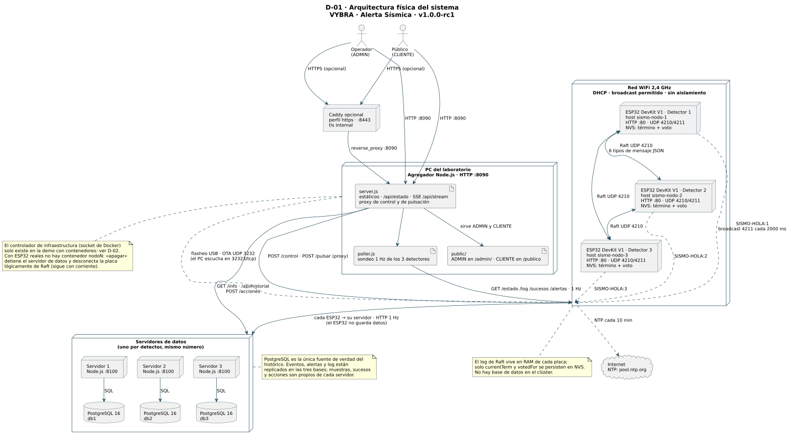

*Figura 8.1. Arquitectura física del sistema. Fuente: diagrama D-01, `entrega/03-diagramas/exportado/D-01-arquitectura-fisica.png`, generado a partir del código y del `README.md`.*

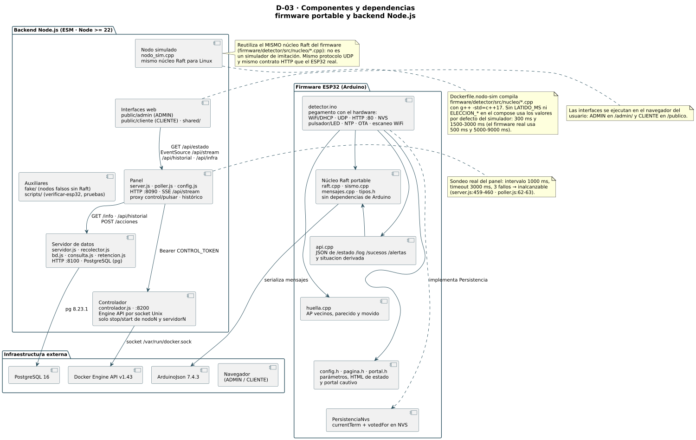

*Figura 8.2. Componentes y dependencias del firmware portable y del backend. Fuente: diagrama D-03, `entrega/03-diagramas/exportado/D-03-componentes-dependencias.png`.*

### 8.2 Flujo de un evento

El recorrido de un evento sintético es el siguiente. Una pulsación en el GPIO4 se mide y se convierte en un objeto `Evento` con identificador único, nodo de origen, nivel, PGA, duración y hora. Si la placa es el líder, agrega la entrada a su log; si es seguidora, se la envía al líder con un mensaje `Forward` y la mantiene pendiente. El líder replica con `Append` y avanza su índice de confirmación cuando dos de los tres nodos la tienen; entonces cada nodo aplica la entrada confirmada a la máquina sísmica y, si hay coincidencia con otro detector en la ventana de diez segundos, crea una alerta. El agregador publica la fotografía actualizada por SSE y las interfaces la muestran; en paralelo, el servidor de datos de cada nodo guarda las entradas en PostgreSQL.

### 8.3 Decisiones de diseño

**El clúster no tiene base de datos.** El log de Raft vive en la RAM de cada placa; solo el término y el voto se persisten en NVS. La persistencia del histórico es responsabilidad de los servidores de datos, fuera del consenso. Esta separación evita que el rendimiento del consenso dependa del disco y mantiene el firmware dentro de su presupuesto de memoria, a costa de la durabilidad que se discute en el apartado 17.

**Un servidor de datos por nodo.** Cada ESP32 tiene asignado un servidor con su propia base, con el mismo número. El servidor consulta a su nodo y guarda; no participa en el consenso ni puede alterar el log. Esa asignación permite distribuir la carga de escritura y demuestra el despliegue de un servicio Node.js sobre tres distribuciones Linux distintas (Fedora, openSUSE y Ubuntu) sin cambiar el código.

**El agregador no inventa estado.** La fotografía del clúster se compone de las respuestas de los nodos. El líder y el quórum se infieren de los roles y términos informados; el apartado 16 explica por qué esa inferencia no equivale a una validación de consenso.

**El despliegue sin hardware usa el mismo núcleo.** Los contenedores `nodo1`, `nodo2` y `nodo3` compilan `firmware/detector/src/nucleo` para Linux y hablan el mismo protocolo UDP 4210 y el mismo contrato HTTP. La demostración en Docker no es una maqueta: es el algoritmo real ejecutándose en otro entorno.

### 8.4 Puertos y canales

La Tabla 8.1 reúne los puertos reales del sistema. Los valores se verificaron en el código, en el `docker-compose.yml` y en las pruebas del 2026-11-18.

**Tabla 8.1.** Puertos y canales de comunicación.

| Componente | Puerto o interfaz | Notas |
|---|---|---|
| ESP32 real (cada nodo) | HTTP 80; Raft UDP 4210; descubrimiento UDP 4211; OTA UDP 3232 (PC en TCP 32323) | Firmware Arduino/ESP32 |
| Nodo simulado en Docker | HTTP 8080 dentro del contenedor, publicado en 9001, 9002 y 9003; Raft UDP 4210 en la red interna | Mismo núcleo Raft compilado para Linux |
| Panel y agregador | Contenedor 8090, publicado en el host en 8095 | `web/server.js` |
| Servidores de datos | Contenedor 8100, publicados en 8101, 8102 y 8103 | Uno por ESP32 |
| PostgreSQL | 5432 solo en la red interna, sin puerto publicado | `postgres:16-alpine` |
| Controlador de infraestructura | 8200 solo en la red interna, sin puerto publicado | Único con socket de Docker |
| Caddy (perfil `https`) | 8443 en el host | Opcional, no arranca por defecto |
| Rutas del panel | `/` redirige a `/admin/`; `/publico` redirige a `/cliente/` | Comprobado con `curl` |

Los mensajes Raft son seis: `VoteReq`, `VoteResp`, `Append`, `AppendResp`, `Forward` y `ForwardAck`. Se codifican como JSON compacto con claves de una o dos letras y se transportan en datagramas UDP. El canal de descubrimiento es un broadcast de texto con el formato `SISMO-HOLA:N` cada dos segundos, que permite a cada nodo aprender la dirección IP de los otros sin configuración manual.

## 9. Diseño del consenso y de la máquina sísmica

### 9.1 Estructuras de datos del núcleo

El núcleo portable define los tipos que comparten el firmware y las pruebas: el rol del nodo, el evento sísmico, la entrada del log, el tipo de mensaje, el mensaje y el suceso que se muestra en el panel.

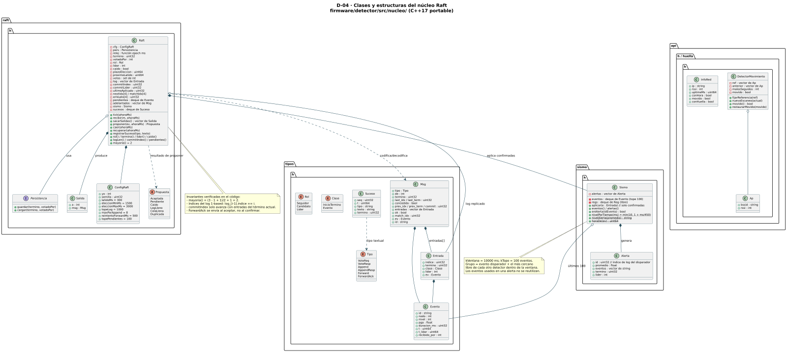

*Figura 9.1. Clases y estructuras del núcleo Raft. Fuente: diagrama D-04, `entrega/03-diagramas/exportado/D-04-clases-nucleo-raft.png`.*

El Código 9.1 reproduce las definiciones de rol, evento y entrada, tomadas de `firmware/detector/src/nucleo/tipos.h`.

**Código 9.1.** Tipos compartidos del núcleo (`firmware/detector/src/nucleo/tipos.h:9-32`).

```cpp
enum class Rol { Seguidor, Candidato, Lider };

// Un sismo detectado por un nodo.
struct Evento {
  std::string id;
  int nodo = 0;
  int nivel = 0;
  float pga = 0;
  uint32_t duracion_ms = 0;
  uint64_t t = 0;          // hora del nodo que lo detectó (ms epoch)
  uint64_t t_lider = 0;    // hora del líder al aceptarlo
  int recibido_por = 0;
};

enum class Clase { InicioTermino, Evento };

// Entrada del log replicado.
struct Entrada {
  uint32_t indice = 0;
  uint32_t termino = 0;
  Clase clase = Clase::Evento;
  int lider = 0;
  Evento ev;
};
```

La distinción entre `Clase::InicioTermino` y `Clase::Evento` es importante: al ganar una elección, el líder agrega una entrada de inicio de término que no representa un sismo pero que permite confirmar por arrastre las entradas heredadas de términos anteriores, de acuerdo con la regla de la sección 5.4.2 del artículo de Raft. La máquina sísmica ignora esas entradas.

### 9.2 Máquina de estados del nodo

Cada nodo se encuentra en uno de tres roles, más un estado de caída simulada que se superpone a los anteriores. La Figura 9.2 resume las transiciones.

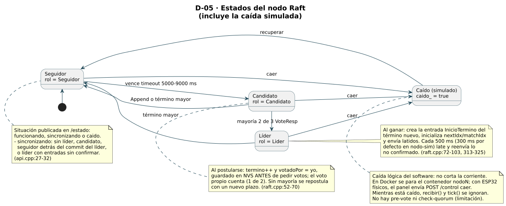

*Figura 9.2. Estados del nodo Raft. Fuente: diagrama D-05, `entrega/03-diagramas/exportado/D-05-estados-nodo-raft.png`.*

| Estado | Transición | Disparador |
|---|---|---|
| Seguidor | Candidato | Vence el tiempo de espera de elección, elegido al azar entre 5.000 y 9.000 ms |
| Candidato | Líder | Obtiene dos de tres votos |
| Candidato | Seguidor | Recibe un `Append` del líder o un término mayor |
| Líder | Seguidor | Recibe un término mayor |
| Cualquiera | Caído | Orden `POST /control` con la acción `caer` |
| Caído | Seguidor | Orden `POST /control` con la acción `recuperar` |

El temporizador se reinicia con cada mensaje válido del líder y con cada voto concedido, y el plazo se sortea de forma uniforme para que dos nodos no se postulen a la vez. En el firmware el reloj que alimenta el núcleo es `esp_timer` en milisegundos, no `millis()`, para evitar el desbordamiento a los 49 días.

### 9.3 Elección de líder

El candidato incrementa el término, se vota a sí mismo, persiste el voto antes de pedir votos a los demás y reinicia su temporizador. La comprobación de log al día implementa la regla de seguridad de la sección 5.4.1 del artículo: un voto solo se concede si el log del candidato es al menos tan actualizado como el del votante; se compara primero el término de la última entrada y después su índice.

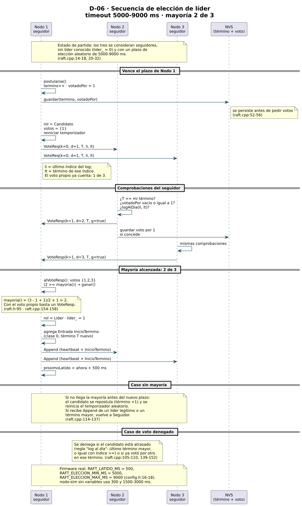

*Figura 9.3. Secuencia de elección de líder. Fuente: diagrama D-06, `entrega/03-diagramas/exportado/D-06-secuencia-eleccion.png`.*

### 9.4 Replicación, latido y confirmación

El líder envía un latido cada 500 ms. Cada `Append` lleva el índice y el término de la entrada anterior, el índice de confirmación del líder y hasta ocho entradas nuevas. El seguidor comprueba la coincidencia en `prev_idx` y `prev_term`; si falla, responde con una pista que permite retroceder en un paso en lugar de probar índice por índice. Para que el tráfico no se multiplique cuando se pierden paquetes, el líder mantiene un tope de cuatro lotes sin respuesta por seguidor y, al llegar una respuesta correcta, vuelve a llenar la ventana sin esperar al latido.

La confirmación se calcula solo sobre entradas del término actual. El Código 9.2 reproduce esa regla: se recorre el log hacia atrás desde el último índice y se confirma el mayor índice que tenga una mayoría de coincidencias, deteniéndose en cuanto se encuentra una entrada de un término anterior.

**Código 9.2.** Confirmación por mayoría (`firmware/detector/src/nucleo/raft.cpp:393-406`).

```cpp
// Avanza commitIndex_ al mayor N del término actual que tenga una mayoría (sección 5.4.2).
void Raft::avanzarCommit() {
  for (uint32_t n = ultimoIndice(); n > commitIndex_; n--) {
    if (terminoEn(n) != termino_) break;  // lo de términos viejos se confirma solo de arrastre
    int votos = 0;
    for (int p = kPrimerNodo; p <= kUltimoNodo; p++)
      if (p == cfg_.yo || matchIdx_[p] >= n) votos++;
    if (votos >= mayoria()) {
      commitIndex_ = n;
      aplicarConfirmadas();
      return;
    }
  }
}
```

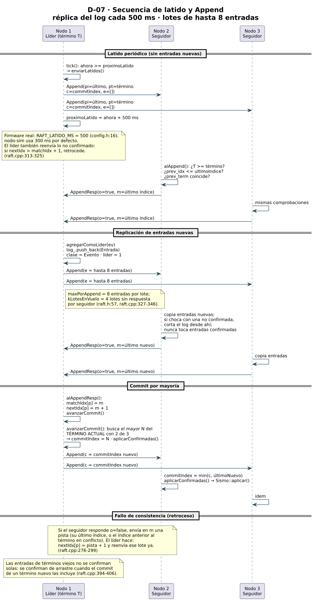

*Figura 9.4. Secuencia de latido y replicación. Fuente: diagrama D-07, `entrega/03-diagramas/exportado/D-07-secuencia-latido-append.png`.*

### 9.5 Reenvío de propuestas desde un seguidor

Un seguidor que recibe un evento no espera a convertirse en líder. Lo coloca en una cola de pendientes y lo envía al líder con un mensaje `Forward`; si no conoce al líder, lo reintenta cada 500 ms. El líder comprueba que el identificador no esté ya en su log y, si es nuevo, lo agrega como una entrada más. Cuando el líder ha aceptado la propuesta, responde `ForwardAck` y el seguidor la retira de su cola. La deduplicación se hace por identificador en ambos lados, de modo que un reintento no crea una entrada duplicada.

La cola de pendientes tiene un tope de cien eventos. Sin ese tope, un seguidor que permaneciera sin quórum acumularía eventos sin límite y reenviaría todos en cada reintento, consumiendo memoria y tráfico. Al llenarse la cola, la propuesta se rechaza con el resultado `ColaLlena` y el firmware responde con el código HTTP 507. El líder, cuando acepta una propuesta, le asigna su propia hora (`t_lider`) y la conserva junto al evento.

La semántica de `ForwardAck` es una limitación conocida: se envía al aceptar, no al confirmar, de modo que si el líder muere justo después de aceptar y antes de replicar en una mayoría el evento puede perderse. El acuse temprano libera la cola antes y el análisis lo señala como compromiso.

### 9.6 Recuperación y resincronización

Cuando un nodo vuelve tras una caída, arranca como seguidor con su log vacío (el log vive en RAM) y espera instrucciones del líder. El líder, que conserva el índice de coincidencia en cero para ese seguidor, le envía lotes desde el índice 1; el nodo los acepta a medida que su log crece y converge.

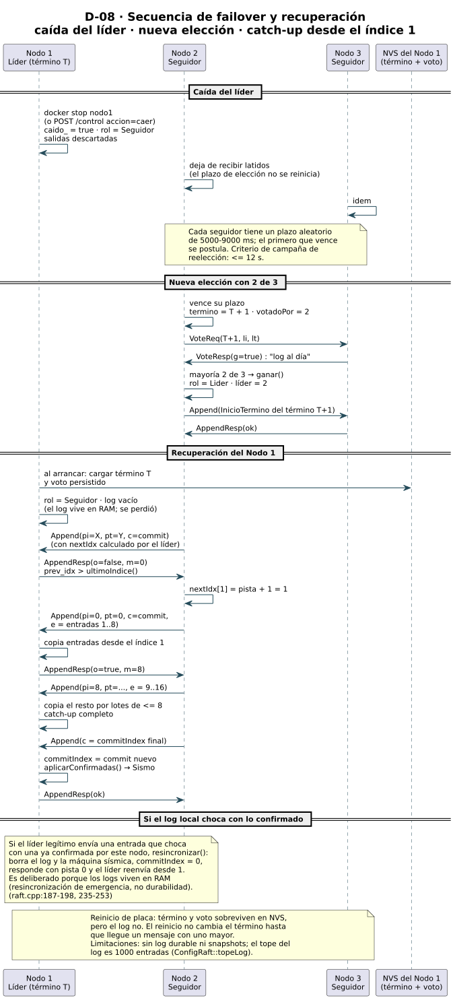

*Figura 9.5. Failover y recuperación. Fuente: diagrama D-08, `entrega/03-diagramas/exportado/D-08-secuencia-failover-recuperacion.png`.*

Existe un caso patológico que el algoritmo clásico no necesita resolver porque asume un log durable. Si una mayoría se reinicia en frío, puede olvidar entradas confirmadas y elegir como líder a un nodo con un log más corto que el de un superviviente; cuando el nuevo líder choca con una entrada que el superviviente considera confirmada, no puede retroceder sin violar la seguridad. La implementación toma una decisión deliberada: el superviviente borra su log y lo copia del líder. Es una desviación de Raft que mantiene la convergencia a costa de la durabilidad de esas entradas; el apartado 17 la recoge como limitación y el 16 discute su justificación.

### 9.7 La máquina sísmica

La máquina sísmica es determinista y consume únicamente entradas confirmadas. Su regla es la siguiente: al aplicar un evento, se busca para cada uno de los otros dos detectores el evento más cercano en el tiempo que esté libre (no consumido por una alerta anterior) y cuya diferencia con el evento disparador no supere los diez segundos. Si se encuentran al menos dos eventos —el disparador y al menos uno de otro detector—, se forma un grupo; se recorta el grupo al intervalo de diez segundos desde el evento más temprano y, si aún quedan dos o más, se emite una alerta con el promedio de niveles. Los eventos usados se marcan como no libres y no pueden reutilizarse.

El nivel de alerta se deriva del promedio: alta si es mayor o igual a 7,5; media si es mayor o igual a 4,5; baja en el resto. La Figura 9.6 muestra la secuencia completa de un evento con pulsador hasta la alerta, y la Figura 9.7 la máquina de estados sísmica.

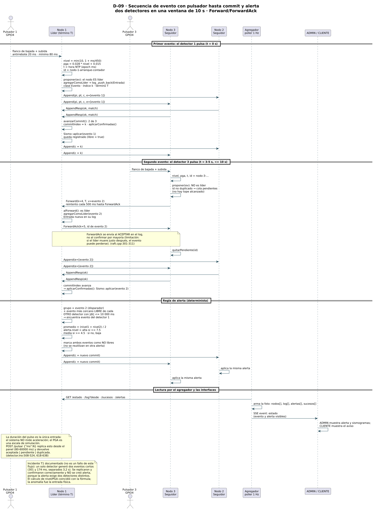

*Figura 9.6. Secuencia de evento con pulsador hasta la alerta. Fuente: diagrama D-09, `entrega/03-diagramas/exportado/D-09-secuencia-evento-alerta.png`.*

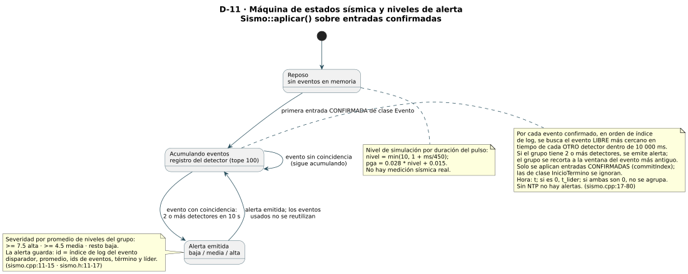

*Figura 9.7. Máquina de estados sísmica. Fuente: diagrama D-11, `entrega/03-diagramas/exportado/D-11-estados-maquina-sismica.png`.*

El Código 9.3 reproduce la función de aplicación y la clasificación del nivel de alerta.

**Código 9.3.** Aplicación determinista de eventos y nivel de alerta (`firmware/detector/src/nucleo/sismo.cpp:11-15` y `:30-80`).

```cpp
const char* Sismo::nivelAlerta(float promedio) {
  if (promedio >= 7.5f) return "alta";
  if (promedio >= 4.5f) return "media";
  return "baja";
}

void Sismo::aplicar(const Entrada& e) {
  if (e.clase != Clase::Evento) return;  // InicioTermino no cambia el estado sísmico
  eventos_.push_back(e.ev);
  regs_.push_back({e.indice, true});
  if (eventos_.size() > kTope) { eventos_.pop_front(); regs_.pop_front(); }
  const uint64_t hE = horaDe(e.ev);
  if (hE == 0) return;
  const size_t pos = eventos_.size() - 1;
  std::vector<size_t> grupo{pos};        // el evento disparador primero
  for (int d = 1; d <= 3; d++) {         // busca el evento libre más cercano de cada otro detector
    if (d == e.ev.nodo) continue;
    // ... se compara la distancia temporal con kVentana = 10000 ms
  }
  if (grupo.size() < 2) return;          // un solo detector no produce alerta
  // promedio de niveles, marca de no reutilizables y emisión de la alerta
}
```

Dos detalles sostienen la reproducibilidad: solo se aplican entradas confirmadas y en orden de índice creciente, con la variable `ultimoAplicado_` para no aplicar dos veces; y la hora del evento se toma del nodo que lo detectó o, si falta, del líder al aceptarlo, de modo que un evento sin hora no puede formar parte de una alerta. Esa dependencia de la hora —sincronizada por NTP— implica que un nodo sin hora funciona para el consenso pero no produce alertas.

### 9.8 Comportamiento sin quórum

Cuando solo queda un nodo disponible, el clúster no puede confirmar. Si el nodo superviviente es el líder, sigue enviando latidos y aceptando propuestas en su log, pero `commit_index` no avanza porque no hay segunda coincidencia. Si es un seguidor, las propuestas se acumulan en la cola de pendientes hasta el tope de cien y se reintentan cada 500 ms. La Figura 9.8 muestra esa secuencia. El agregador refleja la situación con el quórum en falso. Al recuperar un nodo, el commit avanza y los pendientes se confirman.

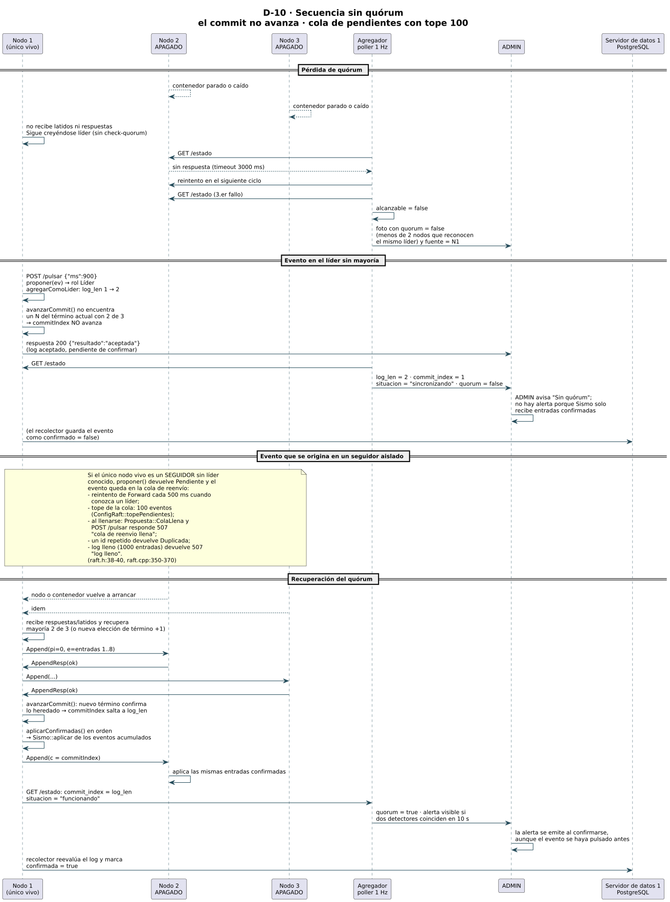

*Figura 9.8. Secuencia sin quórum. Fuente: diagrama D-10, `entrega/03-diagramas/exportado/D-10-secuencia-sin-quorum.png`.*

## 10. Implementación del firmware

### 10.1 Estructura del código

El firmware se divide en dos partes. `detector.ino` contiene solo el pegamento con el hardware: inicialización, WiFi, UDP, HTTP, NVS, puerto serie, botón, LED, NTP, OTA y escaneo de huella. El núcleo portable en `firmware/detector/src/nucleo/` no depende de Arduino: `raft.cpp` implementa el consenso, `sismo.cpp` la máquina de estados, `mensajes.cpp` el códec JSON, `api.cpp` el contrato HTTP, `huella.cpp` la comparación de redes y `tipos.h` los tipos. Esa separación permite compilar el mismo código para el ESP32 y para Linux.

La Tabla 10.1 resume el tamaño de cada archivo del firmware. Los valores provienen del árbol actual; el número de líneas incluye comentarios.

**Tabla 10.1.** Archivos del firmware y longitud.

| Archivo | Líneas | Responsabilidad |
|---|---:|---|
| `detector.ino` | 758 | Pegamento con el hardware y bucle principal |
| `src/nucleo/raft.h` | 168 | Interfaz del núcleo de consenso |
| `src/nucleo/raft.cpp` | 501 | Elección, replicación, confirmación, reenvío y recuperación |
| `src/nucleo/api.h` y `api.cpp` | 34 + 123 | Contrato HTTP en JSON |
| `src/nucleo/mensajes.h` y `mensajes.cpp` | 13 + 127 | Códec de los seis mensajes Raft |
| `src/nucleo/sismo.h` y `sismo.cpp` | 38 + 82 | Máquina de estados sísmica |
| `src/nucleo/huella.h` y `huella.cpp` | 41 + 64 | Detección de movimiento por huella WiFi |
| `src/nucleo/tipos.h` | 66 | Tipos compartidos |
| `config.h` | 31 | Tiempos, puertos y configuración de red |
| `pagina.h` y `portal.h` | 91 + 33 | Página de estado y portal de configuración |

### 10.2 Inicialización y bucle principal

El `setup()` abre la consola serie, configura los pines, abre la persistencia, carga la huella, conecta el WiFi, pide la hora por NTP, crea el núcleo Raft con una semilla aleatoria, abre los sockets UDP de Raft y descubrimiento, registra las rutas HTTP y arranca OTA. El `loop()` ejecuta en cada vuelta, en este orden: vigilancia del WiFi, descubrimiento de nodos, recepción de datagramas Raft, avance del temporizador del núcleo, lectura del botón, atención de una petición HTTP, envío de las salidas pendientes, atención de OTA, vigilancia de la huella, petición periódica de hora, impresión de sucesos y actualización del LED.

El bucle procura no bloquearse, pero algunas llamadas sí pueden retenerlo varios segundos: `handleClient()` atiende un cliente por vez, OTA escribe flash, `Preferences` bloquea al guardar y el escaneo WiFi activo ocupa la radio unos 0,85 s. Con la elección entre 5 y 9 segundos hay margen, pero un cliente lento o una OTA pueden provocar una elección espuria; se documenta como limitación del entorno.

### 10.3 Red y descubrimiento

Las placas se conectan por DHCP y se anuncian con el nombre `sismo-nodo-N`, que se publica por mDNS. Como la resolución mDNS tarda segundos y el sondeo del agregador es de un segundo, el agregador resuelve los nombres por separado cada cinco segundos y usa la IP resultante. Entre placas, el descubrimiento no usa mDNS: cada nodo envía por broadcast UDP al puerto 4211 el texto `SISMO-HOLA:N` cada dos segundos y, al recibirlo, guarda la IP del emisor en una tabla indexada por número de nodo. Si el DHCP asigna una IP nueva, el siguiente anuncio corrige la tabla sin intervención.

La recepción Raft lee hasta ocho datagramas por vuelta, descarta los truncados y actualiza la IP del remitente. El envío codifica el mensaje a JSON y lo escribe por UDP al puerto 4210 de la IP conocida; si el destinatario aún no se descubrió, el mensaje se descarta y se reintenta en el siguiente ciclo.

### 10.4 Pulsador, nivel y PGA

El pulsador se conecta entre el GPIO4 y tierra con la resistencia de pull-up interna, de modo que el pin lee alto en reposo y bajo al presionar. El firmware aplica un antirrebote de 20 ms y mide la duración entre flancos; las pulsaciones de menos de 80 ms se ignoran. La duración se convierte en nivel con `nivel = min(10, 1 + ms/450)` y en PGA con `pga = 0.028 · nivel + 0.015`. El identificador tiene la forma `nodo-N-<arranque>-<contador>`, con un arranque aleatorio por reinicio para que los identificadores no se repitan entre sesiones.

**Código 10.1.** Medición del pulsador y generación del evento (`firmware/detector/detector.ino:526-544` y `:508-524`).

```cpp
void leerBoton(uint64_t ahora) {
  bool crudo = digitalRead(PIN_BOTON) == LOW;
  if (crudo != crudoAnterior) { crudoAnterior = crudo; cambioCrudo = ahora; }
  if (ahora - cambioCrudo < ANTIRREBOTE_MS || crudo == pulsando) return;
  if (crudo) { pulsando = true; tPulso = cambioCrudo; return; }
  pulsando = false;
  uint32_t ms = (uint32_t)(cambioCrudo - tPulso);
  if (ms < PULSO_MIN_MS) return;
  std::string id; int nivel;
  proponerPulso(ms, id, nivel);
}
// proponerPulso: id "nodo-N-<arranque>-<contador>", nivel = min(10, 1 + ms/450),
// pga = 0.028·nivel + 0.015, t = hora UTC del nodo; luego raft->proponer(ev, ahoraMs())
```

El pulsador es un **generador de eventos simulados**. No mide aceleración, no contiene un acelerómetro y no pretende representar un sismo real. La fórmula de nivel y PGA es una escala de simulación declarada, y el propio firmware lo indica en su cabecera. La interfaz muestra la etiqueta de simulacro en las alertas para que no haya ambigüedad.

La Figura 10.1 muestra el prototipo montado y, a su derecha, el detalle del pulsador. La placa es una ESP32 DevKit V1 de 30 pines sobre protoboard, alimentada por el puerto USB, el mismo que se usa para flashear y para la consola serie. El pulsador táctil B3F-4055 se cablea entre el GPIO4 y la tierra común de la protoboard, y aprovecha la resistencia de pull-up interna del microcontrolador; el antirrebote de 20 ms y el mínimo de 80 ms se aplican por firmware. El cableado, la separación entre el pulsador y la placa y la calidad del contacto condicionan la entrada física, cuya incidencia en la prueba T1 se analiza en el apartado 15.5.

<figure class="pareja">
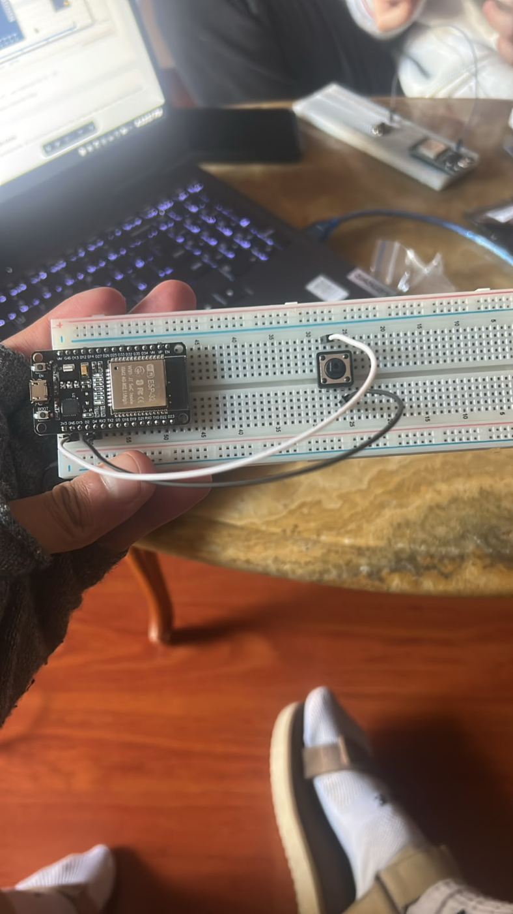
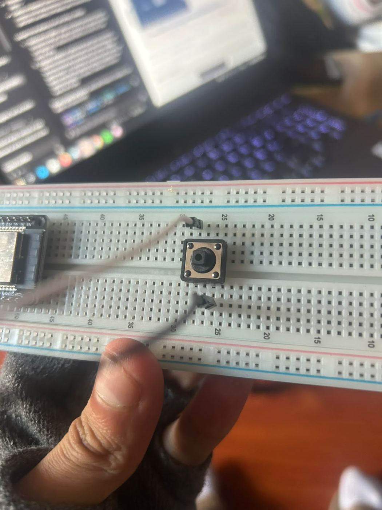
<figcaption><em>Figura 10.1. Prototipo montado: ESP32 DevKit V1 y pulsador B3F-4055 sobre protoboard; fotografía del montaje (campaña física), proporcionada por el autor. Izquierda: vista general; derecha: detalle del pulsador y su cableado. Fuente: <code>entrega/04-evidencias/F-fisicas/fot-FIS-03-prototipo-montado-a.png</code> y <code>entrega/04-evidencias/F-fisicas/fot-FIS-03-prototipo-montado-c.png</code>.</em></figcaption>
</figure>

### 10.5 Persistencia en NVS y portal de configuración

La memoria no volátil del ESP32 guarda tres grupos de datos. En el espacio `raft` se guardan el término (`T`) y el voto (`V`) cada vez que cambian, antes de responder a un mensaje. En el espacio `wifi` se guardan el SSID, la contraseña y una marca de doble reinicio que sirve para detectar la pulsación doble del botón EN. En el espacio `ubic` se guardan la huella de referencia, la marca de placa movida y una marca de huella pendiente que sobrevive a un reinicio.

El portal de configuración se abre si la placa no logra conectarse en los primeros 30 segundos, si se pulsa EN dos veces en menos de tres segundos o si se mantiene el pulsador al encender durante tres segundos. Crea la red `SISMO-D<N>-config`, ejecuta un DNS que redirige cualquier nombre a la placa y sirve un formulario con las redes visibles. Al guardar escribe las credenciales en NVS y reinicia; si pasan cinco minutos sin configuración, reinicia y vuelve a la red anterior. La clave del portal vive en `secretos.h` y no se imprime por la consola serie.

### 10.6 Detección de movimiento por huella WiFi

Cada placa escanea las redes cercanas y guarda como referencia las ocho más fuertes con su intensidad. En escaneos posteriores compara la proporción de redes de referencia que siguen visibles; si cae por debajo del umbral, registra el suceso `movido` y lo conserva en NVS. El escaneo es asíncrono y se evita cuando la placa es líder con entradas sin replicar, porque desvía la radio casi un segundo. La función es auxiliar: no participa en el consenso, pero enriquece el estado que muestra el panel.

### 10.7 Contrato HTTP del nodo

El nodo expone una API HTTP mínima en el puerto 80. Todas las respuestas llevan `Cache-Control: no-store` y `Access-Control-Allow-Origin: *`. La Tabla 10.2 resume las rutas.

**Tabla 10.2.** API HTTP del nodo ESP32.

| Método | Ruta | Respuesta |
|---|---|---|
| GET | `/` | Página de estado embebida, servida desde flash |
| GET | `/estado` | 18 claves: nodo, rol, caído, término, votado por, líder conocido, longitud del log, índice de confirmación, pendientes, log lleno, secuencia de sucesos, hora disponible, IP, RSSI, uptime, movido, huella y situación |
| GET | `/log?desde=N` | Entradas del log paginadas de 50 en 50 |
| GET | `/sucesos?desde=S` | Sucesos nuevos desde la secuencia indicada |
| GET | `/alertas` | Alertas derivadas de la máquina sísmica |
| POST | `/control` | `{"accion":"caer"}` o `{"accion":"recuperar"}` |
| POST | `/pulsar` | `{"ms":N}` entre 80 y 60.000 ms |
| POST | `/huella` | Fija una nueva referencia de huella en el siguiente escaneo |

### 10.8 LED, OTA y compilación

El LED azul integrado en el GPIO2 informa del estado: fijo cuando el nodo conoce un líder, parpadeo a 1 Hz cuando no lo conoce, parpadeo rápido mientras se pulsa y apagado cuando el nodo está caído o sin WiFi. La actualización OTA usa ArduinoOTA con nombre `sismo-nodo-N` y contraseña tomada de `secretos.h`; el script `cargar.sh` compila con la macro `-DNODO=1`, `2` o `3`, identifica la placa por su MAC registrada y flashea por USB o por WiFi.

La Tabla 10.3 resume los artefactos de compilación de los tres nodos.

**Tabla 10.3.** Artefactos de compilación del firmware (2026-11-18).

| Artefacto | Nodo 1 | Nodo 2 | Nodo 3 |
|---|---:|---:|---:|
| `detector.ino.bin` | 1.105.728 B | 1.105.728 B | 1.105.712 B |
| `detector.ino.bootloader.bin` | 24.992 B | 24.992 B | 24.992 B |
| `detector.ino.partitions.bin` | 3.072 B | 3.072 B | 3.072 B |
| `boot_app0.bin` | 8.192 B | 8.192 B | 8.192 B |
| `detector.ino.merged.bin` | 4.194.304 B | 4.194.304 B | 4.194.304 B |
| Uso de flash de la aplicación | 84 % | 84 % | 84 % |
| Uso de RAM | 54.264 B (16 %) | 54.264 B (16 %) | 54.264 B (16 %) |

## 11. Implementación del agregador y las interfaces

### 11.1 El servidor del panel

`web/server.js` es un servidor HTTP sobre `node:http`, sin dependencias externas. Sirve los archivos estáticos, expone la fotografía del clúster, mantiene el flujo SSE, reenvía las órdenes a los nodos, consulta el histórico a los servidores de datos y coordina el apagado y encendido con el controlador. La Tabla 11.1 resume las rutas.

**Tabla 11.1.** API HTTP del agregador.

| Método | Ruta | Función |
|---|---|---|
| GET | `/` | Redirige a `/admin/` |
| GET | `/publico` | Redirige a `/cliente/` |
| GET | `/api/estado` | Fotografía del clúster con posiciones fijas de los detectores |
| GET | `/api/stream` | Flujo SSE con el estado y un latido de vida |
| GET | `/api/infra` | Estado de la infraestructura leído del controlador |
| GET | `/api/servidores` | Estado de los tres servidores de datos |
| GET | `/api/historial` | Histórico paginado y filtrado |
| GET | `/api/registro` | Detalle de un registro con su JSON original |
| GET | `/api/retencion` | Política de retención y registros afectados |
| GET | `/api/publico/historial` | Histórico público, solo alertas y eventos confirmados |
| POST | `/api/nodos/:n/control` | Reenvía una orden de caída o recuperación al nodo |
| POST | `/api/nodos/:n/pulsar` | Reenvía una pulsación simulada al nodo |
| POST | `/api/infra/servidores/:n/:accion` | Apaga o enciende un servidor de datos |

El servidor valida el cuerpo de las peticiones con un tope de 4 KB, exige el tipo `application/json` en las peticiones de control y comprueba que el encabezado `Origin`, si existe, coincida con el host del panel. Esas medidas no sustituyen a la autenticación, pero impiden que una página de otro sitio ordene un apagado mediante un formulario simple. La protección contra recorrido de rutas se aplica antes de normalizar la URL, porque `URL` elimina segmentos `..` en silencio.

### 11.2 El sondeo y la fotografía del clúster

`web/poller.js` sondea los tres nodos a un hertzio con un tiempo límite de tres segundos. Un nodo se considera inalcanzable tras tres fallos consecutivos para que la fotografía no cambie por una pérdida puntual. Además de `/estado`, trae los sucesos nuevos y, solo de la fuente elegida, el log y las alertas; la fuente es el líder o, sin líder, el nodo disponible con mayor índice de confirmación.

El cálculo del líder y del quórum se reproduce en el Código 11.1.

**Código 11.1.** Inferencia de líder y quórum (`web/poller.js:85-106`).

```js
function calcularLiderYFuente() {
  const lideres = info.filter((x) => disponible(x) && x.estado.rol === 'lider');
  lideres.sort((a, b) => (b.estado.termino - a.estado.termino) || (a.n - b.n));
  const lider = lideres[0]?.n ?? null;

  // Quórum: al menos 2 nodos disponibles que reconocen al mismo líder.
  const votos = new Map();
  for (const x of info) {
    if (!disponible(x)) continue;
    const l = x.estado.lider_conocido;
    if (l) votos.set(l, (votos.get(l) ?? 0) + 1);
  }
  const quorum = Math.max(0, ...votos.values()) >= 2;

  let fuente = lider;
  if (fuente === null) {
    const candidatos = info.filter(disponible);
    candidatos.sort((a, b) => (b.estado.commit_index - a.estado.commit_index) || (a.n - b.n));
    fuente = candidatos[0]?.n ?? null;
  }
  return { lider, quorum, fuente };
}
```

La fotografía que se publica contiene la marca de tiempo, el indicador de quórum, el líder, la fuente, el estado de cada nodo, el log de la fuente, las alertas de la fuente y los sucesos acumulados de los tres nodos, ordenados por hora. El poller solo emite un cambio cuando la fotografía comparable cambia; los campos volátiles —uptime y RSSI— se excluyen de la comparación para no saturar el flujo.

### 11.3 Server-Sent Events

El flujo SSE se sirve en `/api/stream`. El servidor responde con `Content-Type: text/event-stream`, envía una fotografía inicial y otra cada vez que el poller emite un cambio, y cada cinco segundos envía un evento `vivo`. Si el cliente deja de leer y el búfer supera un megabyte, la conexión se destruye; al cerrarse la petición se eliminan el temporizador y el manejador.

**Código 11.2.** Flujo SSE (`web/server.js:117-144`).

```js
function stream(req, res) {
  res.writeHead(200, { 'Content-Type': 'text/event-stream', 'Cache-Control': 'no-cache', Connection: 'keep-alive' });
  const escribir = (texto) => { if (res.writableLength > maxPendienteSse) return res.destroy(); res.write(texto); };
  const enviar = (foto) => escribir(`event: estado\ndata: ${JSON.stringify(conUbicaciones(foto))}\n\n`);
  const ping = setInterval(() => escribir(`event: vivo\ndata: ${JSON.stringify({ t: Date.now() })}\n\n`), vivoMs);
  poller.on('cambio', enviar);
  const limpiar = () => { clearInterval(ping); poller.off('cambio', enviar); };
  req.on('close', limpiar); res.on('close', limpiar); res.on('error', limpiar);
  enviar(poller.foto());
}
```

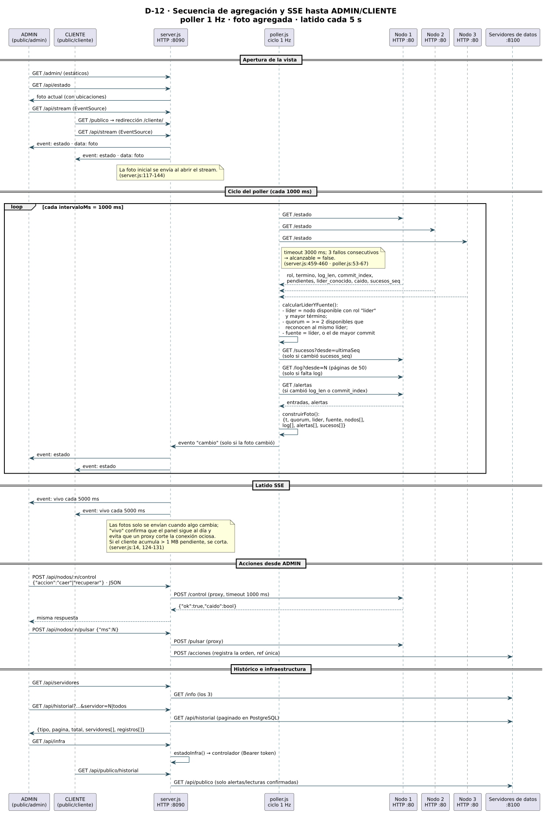

*Figura 11.1. Agregación y SSE hasta las interfaces. Fuente: diagrama D-12, `entrega/03-diagramas/exportado/D-12-secuencia-agregacion-sse.png`.*

### 11.4 Panel ADMIN

El panel administrativo es una aplicación React construida desde `web/admin-src/` y servida como archivos estáticos desde `web/public/admin/`. Se accede por `/admin/` y la raíz redirige allí. Sus nueve secciones son Panorama, Sismógrafos, Alertas, Histórico, Clúster Raft, Servidores, Detectores, Registros y Configuración. La Figura 11.2 muestra la sección Panorama, la Figura 11.3 la sección Clúster Raft y la Figura 11.4 la sección Detectores.

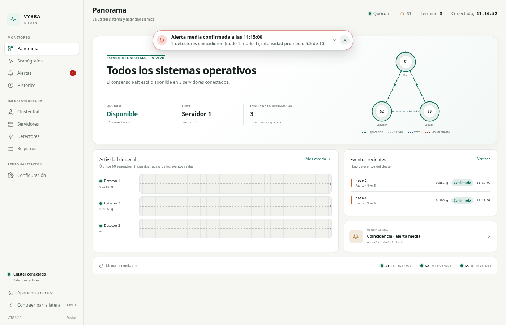

*Figura 11.2. Panel ADMIN, sección Panorama. Fuente: captura del stack real en `http://127.0.0.1:8095/admin/`, `entrega/04-evidencias/B-interfaz/cap-REF-OP-01-panorama.png`.*

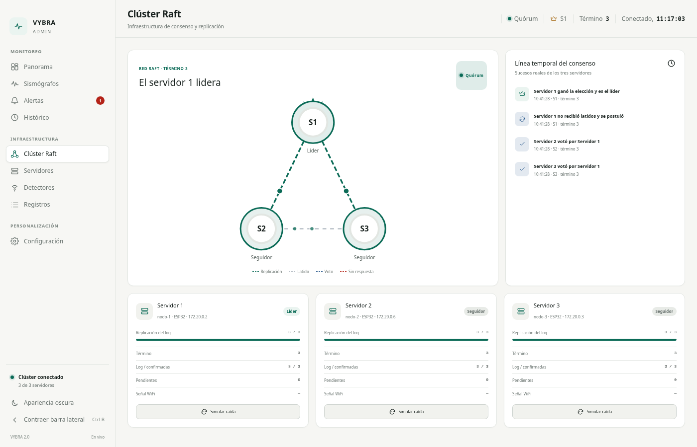

*Figura 11.3. Panel ADMIN, sección Clúster Raft. Fuente: captura del stack real en `http://127.0.0.1:8095/admin/`, `entrega/04-evidencias/B-interfaz/cap-REF-OP-05-raft.png`.*

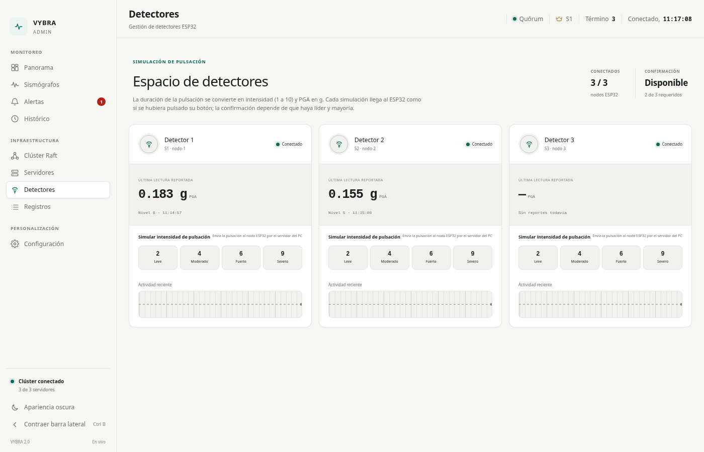

*Figura 11.4. Panel ADMIN, sección Detectores. Fuente: captura del stack real, `entrega/04-evidencias/B-interfaz/cap-REF-OP-07-detectores.png`.*

Panorama concentra la salud del sistema y la actividad sísmica; Sismógrafos muestra las señales sincronizadas; Alertas lista las coincidencias; Histórico consulta las bases con pestañas por tipo, filtros por servidor, nodo, categoría, estado y fechas, búsqueda, paginación y detalle con el JSON guardado; Clúster Raft presenta el líder, el término y la línea de tiempo; Servidores muestra las tarjetas con sus botones de apagado y encendido; Detectores gestiona los ESP32; Registros es el historial replicado con exportación a CSV; Configuración reúne preferencias, sonido y ensayo de la alarma.

### 11.5 Vista CLIENTE

La vista pública se sirve en `/publico`, que redirige a `/cliente/`. Está orientada a una persona sin conocimientos técnicos: muestra el estado del servicio, el último sismo, el historial público de alertas y lecturas confirmadas, un mapa con la zona del evento, el protocolo de actuación y los ajustes de accesibilidad, idioma y rango. No expone direcciones IP, estado WiFi, términos de Raft, líder, órdenes ni muestras internas. La Figura 11.5 muestra la vista pública.

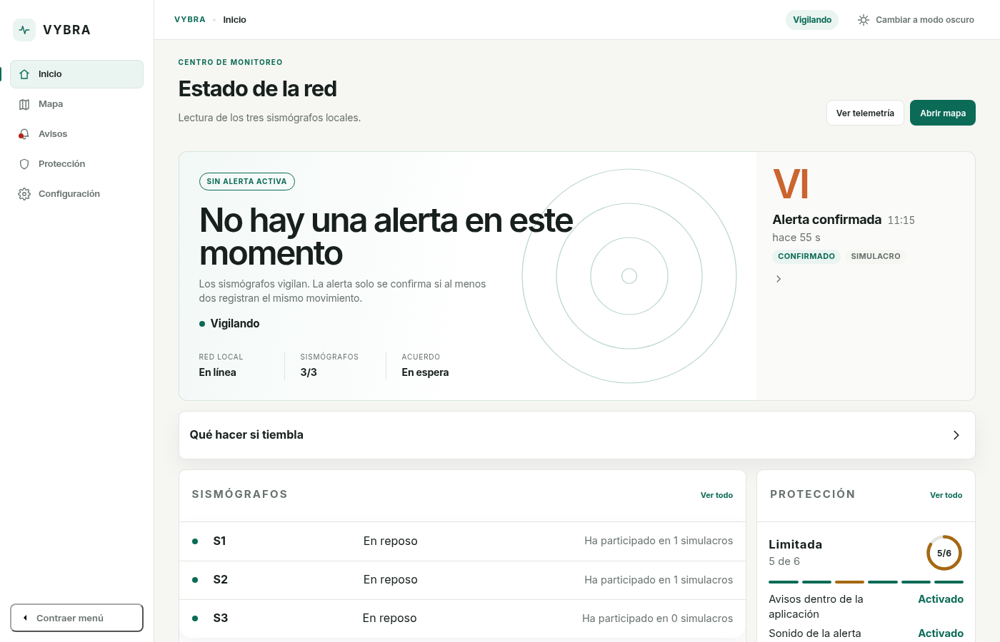

*Figura 11.5. Vista CLIENTE. Fuente: captura del stack real, `entrega/04-evidencias/B-interfaz/cap-REF-CLI-01-publico.png`.*

Ambas interfaces consumen el mismo `/api/stream`, pero no comparten el mapa. El ADMIN dibuja un mapa SVG propio: la proyección se calcula en el navegador, sin teselas externas ni bibliotecas de mapas. El CLIENTE usa Leaflet vendorizado en `web/public/cliente/vendor/leaflet/` y teselas de OpenStreetMap (`https://tile.openstreetmap.org/{z}/{x}/{y}.png`, `web/public/cliente/js/cliente-app.js:688`); sin acceso a las teselas el mapa base no se dibuja. Las dependencias externas son, por tanto, las teselas de OSM y la tipografía Inter servida desde Google Fonts; la interfaz funciona sin esta última, aunque cambia la apariencia. `README.md` §7 describe un «mapa SVG propio (sin Leaflet ni teselas externas)» para ambas vistas: esa afirmación está desactualizada respecto del CLIENTE. La Figura 11.6 muestra la adaptación a un ancho de 390 píxeles.

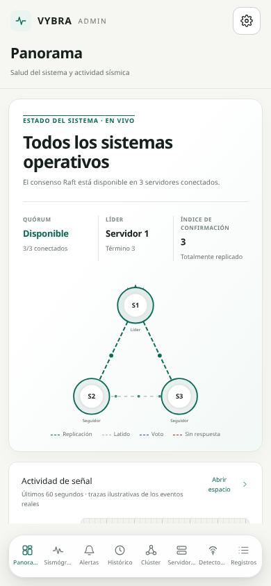

*Figura 11.6. Panel ADMIN en vista móvil. Fuente: captura del stack real, `entrega/04-evidencias/B-interfaz/cap-REF-OP-18-movil.png`.*

## 12. Servidores de datos y persistencia

### 12.1 Modelo de persistencia

Cada ESP32 tiene asignado un servidor de datos con el mismo número. Los ESP32 toman los datos y los transportan mediante el consenso, pero no los guardan; el servidor los consulta por HTTP y los escribe en su PostgreSQL. Como el log de Raft está replicado, los eventos, las alertas y las entradas de log existen en las tres bases; las muestras de estado, los sucesos y las acciones son propios de cada nodo.

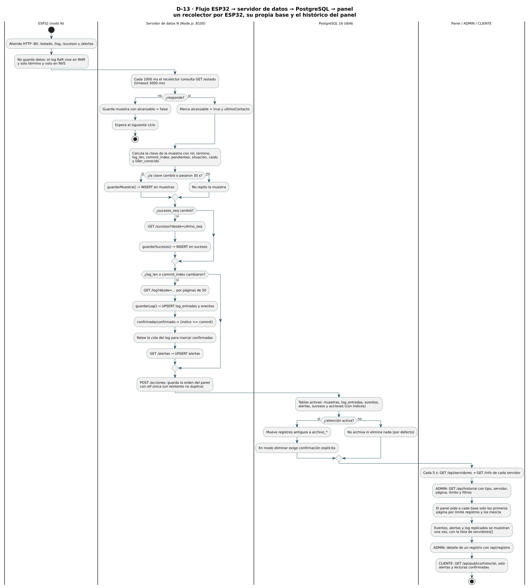

*Figura 12.1. Flujo de los servidores de datos. Fuente: diagrama D-13, `entrega/03-diagramas/exportado/D-13-flujo-servidores-datos.png`.*

La diversidad de sistemas operativos —Fedora 42, openSUSE Leap 15.6 y Ubuntu 24.04— es deliberada: demuestra que el mismo código Node.js y el mismo contrato HTTP funcionan sobre distribuciones distintas.

### 12.2 El recolector

El recolector consulta a su nodo a un hertzio con un tiempo límite de tres segundos. Si el nodo no responde, registra una muestra como no alcanzable; si responde, guarda una muestra cuando cambia algún campo relevante o cuando han pasado 30 segundos, sincroniza los sucesos nuevos, trae las entradas de log que falten y refresca las alertas cuando cambia el par longitud-commit.

### 12.3 Esquema de la base

Hay seis tablas activas y seis de archivo con la misma estructura: `muestras` guarda el estado del nodo con su JSON, `log_entradas` las entradas del log con su clave y confirmación, `eventos` cada evento, `alertas` el promedio, nivel y eventos, `sucesos` las elecciones y caídas, y `acciones` las pruebas y órdenes con su referencia idempotente.

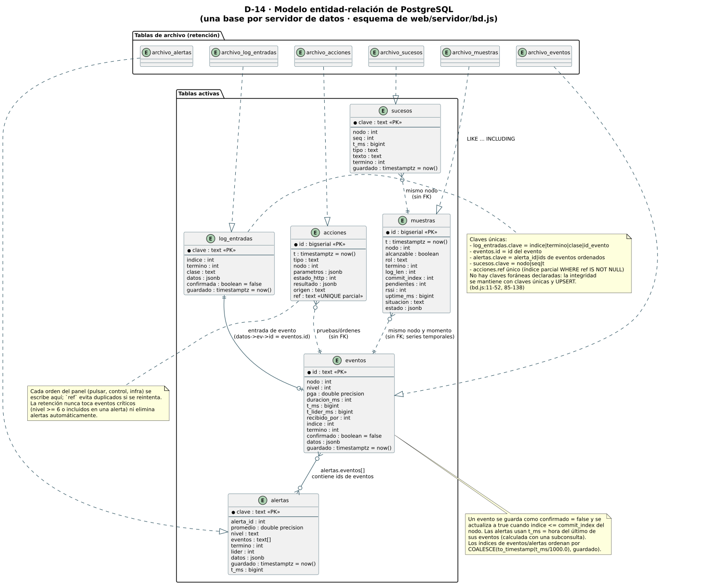

*Figura 12.2. Modelo entidad-relación de PostgreSQL. Fuente: diagrama D-14, `entrega/03-diagramas/exportado/D-14-modelo-er-postgresql.png`.*

El Código 12.1 reproduce un fragmento del esquema tal como se crea al arrancar el servidor.

**Código 12.1.** Fragmento del esquema (`web/servidor/bd.js:11-27`).

```sql
CREATE TABLE IF NOT EXISTS muestras (
  id bigserial PRIMARY KEY, t timestamptz NOT NULL DEFAULT now(), nodo int NOT NULL, alcanzable boolean NOT NULL,
  rol text, termino int, log_len int, commit_index int, pendientes int, rssi int, uptime_ms bigint, situacion text, estado jsonb);
CREATE INDEX IF NOT EXISTS muestras_t ON muestras (t DESC);
CREATE TABLE IF NOT EXISTS log_entradas (
  clave text PRIMARY KEY, indice int NOT NULL, termino int NOT NULL, clase text NOT NULL, datos jsonb NOT NULL,
  confirmada boolean NOT NULL DEFAULT false, guardado timestamptz NOT NULL DEFAULT now());
CREATE INDEX IF NOT EXISTS log_indice ON log_entradas (indice);
CREATE TABLE IF NOT EXISTS eventos (
  id text PRIMARY KEY, nodo int, nivel int, pga double precision, duracion_ms int, t_ms bigint, t_lider_ms bigint,
  recibido_por int, indice int, termino int, confirmado boolean NOT NULL DEFAULT false, datos jsonb NOT NULL,
  guardado timestamptz NOT NULL DEFAULT now());
```

La idempotencia se apoya en claves naturales: identificador único de evento, `índice|término|clase|id` para el log, identificador y lista ordenada de eventos para las alertas, `nodo|secuencia|hora` para los sucesos y un `ref` UUID único para las acciones, con índice único parcial para que un reintento no duplique el registro. Las muestras no tienen clave natural; el recolector evita repetirlas cuando el estado no cambió.

### 12.4 Consultas e histórico

El servidor de datos expone `/info`, `/salud`, `/api/historial`, `/api/registro`, `/api/publico`, `/retencion` y `POST /acciones`. El panel consulta el histórico mediante `/api/historial`, que acepta los tipos `eventos`, `alertas`, `muestras`, `sucesos`, `log` y `acciones`; filtros por servidor, nodo, categoría, estado, rango de fechas, búsqueda de texto y orden; y paginación con límite máximo de 200 registros. La paginación y los filtros se resuelven en PostgreSQL con `LIMIT`, `OFFSET` y `count(*)`, de modo que el histórico nunca se carga completo. Los valores viajan como parámetros, lo que evita la inyección SQL, y el comodín de la búsqueda se trata como texto.

El modo `todos` pide a cada base solo los primeros registros necesarios y mezcla los resultados. Para los tipos replicados —eventos, alertas y log— el agregador deduplica por clave y muestra cada registro una vez con la lista de servidores donde aparece. El modo tiene un tope de mil registros fusionados; si una base no responde, las demás siguen y la respuesta indica el error, con un reintento ante fallos de red o 5xx.

### 12.5 Retención y crecimiento

La retención está desactivada por defecto. Cuando se activa con `RETENCION_ACTIVA=si`, se aplica a los 60 segundos del arranque y cada 24 horas. Los eventos críticos —nivel mayor o igual a 6 o pertenecientes a una alerta— y las alertas nunca se eliminan automáticamente; los demás registros se archivan en las tablas `archivo_*` o se eliminan, y la eliminación exige confirmación explícita.

El crecimiento medido con PostgreSQL 16 e índices, sobre cinco mil filas por tabla, es de unos 590 bytes por muestra, 430 bytes por evento más unos 540 por su entrada de log y 250 por suceso. Una muestra cada 30 segundos implica 2.880 al día, aproximadamente 1,7 MB diarios o 0,6 GB al año por servidor; mil eventos diarios añaden cerca de 1 MB. La recomendación inicial es archivar muestras a los 30 días y sucesos al año, y dejar eventos y alertas sin retención.

## 13. Infraestructura, despliegue y seguridad

### 13.1 El despliegue Docker

El archivo `docker-compose.yml` define once servicios por defecto y uno opcional en el perfil `https`. La Tabla 13.1 los resume. **Tabla 13.1.** Servicios de `docker-compose.yml`.

| # | Servicio | Imagen o construcción | Contenedor | Puerto host | Perfil |
|---|---|---|---|---|---|
| 1 | `nodo1` | Construcción con `Dockerfile.nodo-sim` sobre Debian 12 | `sismo-nodo-1` | 9001 a 8080 | Por defecto |
| 2 | `nodo2` | Igual | `sismo-nodo-2` | 9002 a 8080 | Por defecto |
| 3 | `nodo3` | Igual | `sismo-nodo-3` | 9003 a 8080 | Por defecto |
| 4 | `db1` | `postgres:16-alpine` | `sismo-db-1` | Sin publicar | Por defecto |
| 5 | `db2` | `postgres:16-alpine` | `sismo-db-2` | Sin publicar | Por defecto |
| 6 | `db3` | `postgres:16-alpine` | `sismo-db-3` | Sin publicar | Por defecto |
| 7 | `servidor1` | Construcción con `Dockerfile.fedora` sobre Fedora 42 | `sismo-servidor-1` | 8101 a 8100 | Por defecto |
| 8 | `servidor2` | Construcción con `Dockerfile.suse` sobre openSUSE Leap 15.6 | `sismo-servidor-2` | 8102 a 8100 | Por defecto |
| 9 | `servidor3` | Construcción con `Dockerfile.ubuntu` sobre Ubuntu 24.04 | `sismo-servidor-3` | 8103 a 8100 | Por defecto |
| 10 | `controlador` | Construcción con `Dockerfile.controlador` sobre Alpine | `sismo-controlador` | Sin publicar | Por defecto |
| 11 | `panel` | Construcción de `web` sobre `node:22.22-alpine` | `sismo-panel` | 8095 a 8090 | Por defecto |
| 12 | `https` | `caddy:2-alpine` | `sismo-https` | 8443 | `https` |

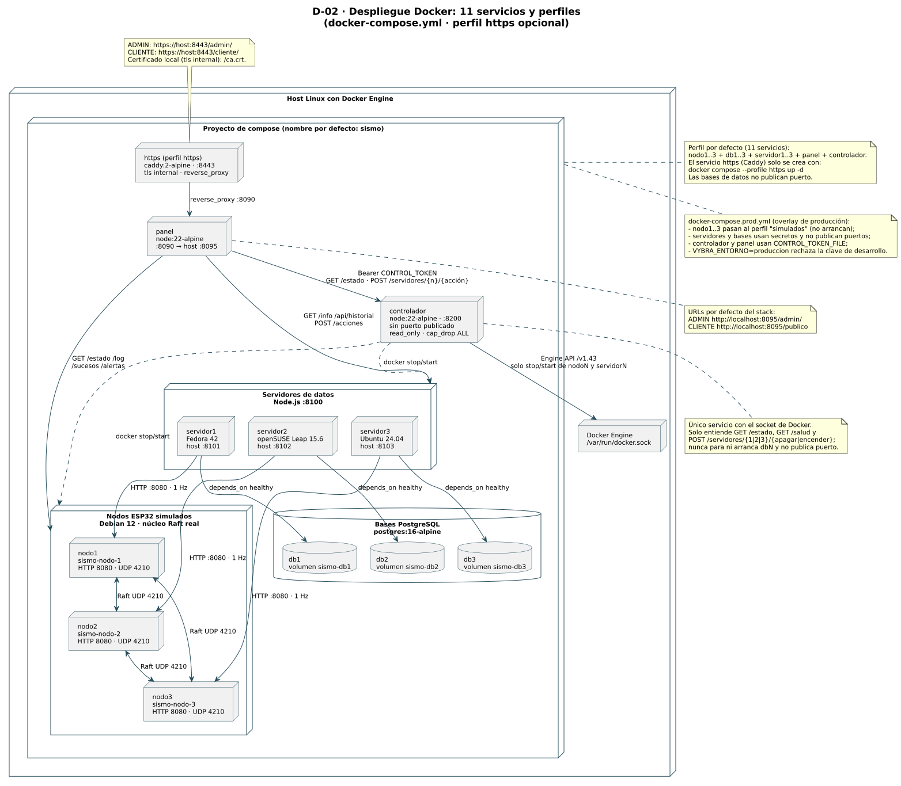

*Figura 13.1. Despliegue Docker. Fuente: diagrama D-02, `entrega/03-diagramas/exportado/D-02-despliegue-docker.png`.*

Los servicios con ancla común tienen healthcheck y reinicio automático: los nodos usan `nodo-sim --salud`, los servidores consultan `/salud` y las bases usan `pg_isready`; el panel depende de que nodos y servidores estén sanos y no tiene healthcheck propio.

El perfil `https` añade Caddy con TLS interno en el puerto 8443, proxy inverso al panel y entrega de su autoridad de certificación en `/ca.crt`.

### 13.2 Producción y secretos

El archivo `docker-compose.prod.yml` se aplica sobre el compose base y endurece el despliegue: los nodos simulados pasan a un perfil que no se arranca, los servidores dejan de publicar puertos, la contraseña de PostgreSQL y el token del controlador llegan como secretos de archivo y `VYBRA_ENTORNO=produccion` hace que los servidores rechacen la contraseña de desarrollo o vacía. En producción se conectan ESP32 reales mediante `NODO1_URL`, `NODO2_URL` y `NODO3_URL`.

En desarrollo el compose usa valores declarados como solo de desarrollo: la contraseña `vybra` y el token `vybra-control-dev`, que el servidor advierte al arrancar. Las credenciales del firmware —WiFi, OTA y portal— viven en `firmware/detector/secretos.h`, excluido por `.gitignore`; la plantilla es `secretos.ejemplo.h`. Las evidencias incluyen identificadores de red saneados y la nota de saneado correspondiente.

### 13.3 El controlador de infraestructura

El controlador es el único servicio con acceso al socket de Docker. Su superficie de ataque se reduce por diseño: solo entiende tres rutas —`GET /estado`, `GET /salud` y `POST /servidores/{1|2|3}/{apagar|encender}`— y de la petición solo extrae un número entre 1 y 3 y una de dos palabras. No acepta nombres, identificadores ni comandos, y solo actúa sobre contenedores de su propio proyecto de compose con los servicios `nodoN` y `servidorN`. Las bases `dbN` nunca se paran ni se arrancan: solo se consultan para informar de su estado. El Código 13.1 reproduce el enrutado y la comprobación del token.

**Código 13.1.** Superficie del controlador (`web/controlador/controlador.js:138-165`).

```js
const RUTA = /^\/servidores\/([1-3])\/(apagar|encender)$/;
const igual = (a, b) => { /* comparación en tiempo constante */ };

export function crearManejador({ controlador, token = '' }) {
  return async (req, res) => {
    req.resume();
    const ruta = (req.url || '').split('?')[0];
    if (req.method === 'GET' && ruta === '/salud') return responder(res, 200, { ok: true });
    if (token && !igual((req.headers.authorization || '').replace(/^Bearer /, ''), token))
      return responder(res, 401, { error: 'no autorizado' });
    if (req.method === 'GET' && ruta === '/estado') return responder(res, 200, await controlador.estado());
    const m = RUTA.exec(ruta);
    if (req.method === 'POST' && m) {
      const n = Number(m[1]);
      return responder(res, 200, await (m[2] === 'apagar' ? controlador.apagar(n) : controlador.encender(n)));
    }
    return responder(res, 404, { error: 'no existe' });
  };
}
```

El contenedor corre con el sistema de archivos de solo lectura, sin capacidades y con `no-new-privileges`, no publica puertos y compara el token en tiempo constante. El apagado tiene un cerrojo por servidor y espera la confirmación de Docker; detiene primero el nodo y después el servidor, para que el servidor registre que su nodo dejó de responder, y el encendido arranca el nodo y luego el servidor, exigiendo que la base esté encendida porque el controlador nunca la arranca.

### 13.4 El panel ante la infraestructura

El panel no habla con Docker. Al confirmar un apagado o un encendido, lee el estado del controlador para saber si el servidor es simulado o físico, registra la orden en la base del servidor afectado, llama al controlador y devuelve un mensaje con las consecuencias. Si el servidor es físico, el apagado detiene el servidor de datos y ordena al ESP32 la caída lógica; la placa sigue alimentada pero Raft la considera caída. El encendido arranca el servidor y ordena la recuperación. Esa distinción se muestra en la interfaz, y la Figura 13.2 recoge la tarjeta de un servidor con su nodo, su base y el botón de apagado.

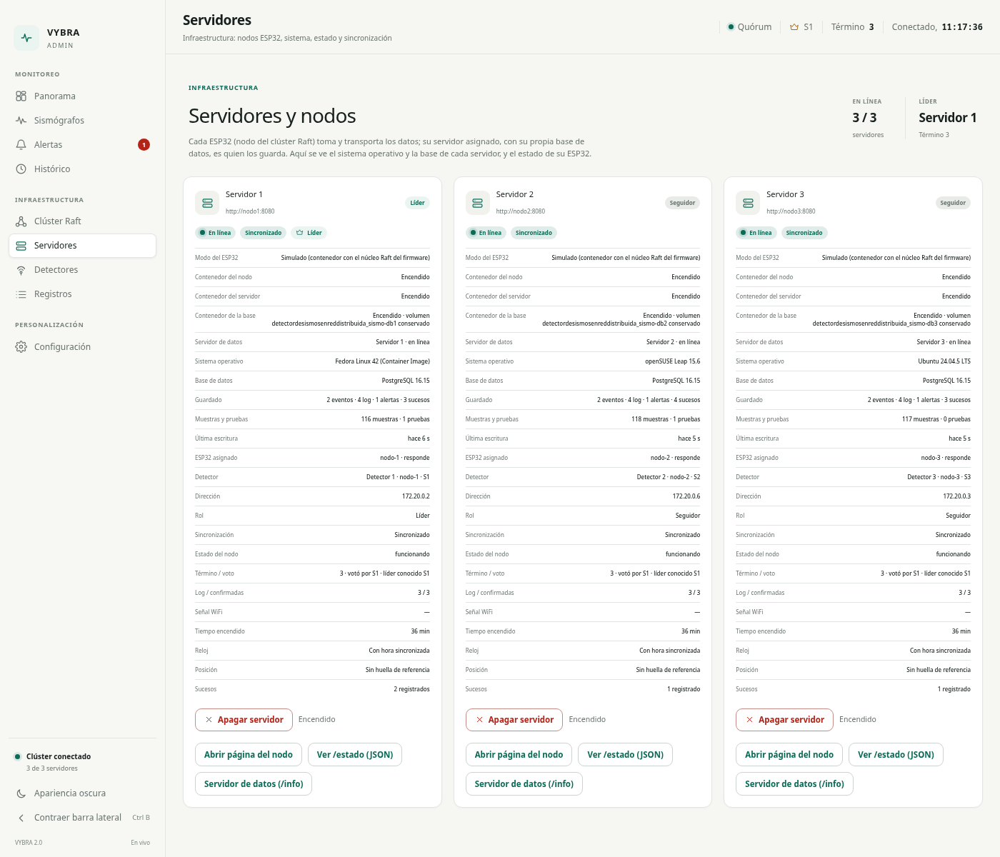

*Figura 13.2. Panel ADMIN, sección Servidores. Fuente: captura del stack real, `entrega/04-evidencias/B-interfaz/cap-REF-OP-06-servidores.png`.*

## 14. Metodología de pruebas

### 14.1 Estrategia por niveles

La validación se organiza en seis niveles, cuatro automatizados y reproducibles sin hardware, más la compilación del firmware y la campaña física (Tabla 14.1).

**Tabla 14.1.** Niveles de validación.

| Nivel | Objeto | Herramienta | Alcance |
|---|---|---|---|
| 1 | Núcleo Raft y máquina sísmica | Suite C++ con red y reloj simulados | Elección, replicación, confirmación, reenvío, recuperación, reglas de alerta y contrato JSON |
| 2 | Agregador, interfaces y utilidades | `node:test` con dobles de prueba | Poller, SSE, rutas HTTP, estáticos, geo, controlador contra un socket Unix simulado, Raft nativo con tres procesos |
| 3 | Persistencia | Tres PostgreSQL efímeros con `REQUIRE_DB=1` | Esquema, escritura idempotente, consultas, filtros, paginación, retención y vista pública |
| 4 | Integración Docker | Proyecto de compose aislado `vybraint` | Apagado y encendido real de los tres servidores, volúmenes, cambio de líder, pérdida de quórum y recuperación |
| 5 | Firmware | `arduino-cli` para los tres nodos y compilación del nodo simulado | Compilación sin errores, tamaños y uso de memoria |
| 6 | Campaña física | Protocolo con las tres placas y captura pasiva | Identidad, red, clúster, evento con pulsador, failover y particiones |

### 14.2 Suite C++

La suite C++ se ejecuta en el equipo de desarrollo sobre una copia de `firmware/test` y `firmware/detector/src`. Compila cinco binarios —`test_api`, `test_huella`, `test_mensajes`, `test_raft` y `test_sismo`— con `make` y ArduinoJson 7.4.3, sobre una red simulada con reloj virtual que entrega los mensajes de forma controlada y permite reproducir pérdidas, lotes adelantados, reinicios y falta de quórum sin depender de la WiFi real. Suma 78 casos.

### 14.3 Suite JavaScript

La suite JavaScript usa `node:test` con siete archivos. El agregador se prueba con un servidor HTTP real y dobles de `fetch`; el controlador contra un Docker simulado por socket Unix que registra cada petición; y el Raft nativo con tres procesos del nodo simulado que se hablan por UDP. Sin servicios externos ejecuta 60 casos y omite 15; con tres PostgreSQL reales ejecuta 70 y omite 5 de infraestructura, que aporta la integración Docker.

### 14.4 Persistencia y Docker

`npm run test:db` levanta tres PostgreSQL efímeros, uno por servidor, y ejecuta la suite con `REQUIRE_DB=1`: si falta una base, las pruebas fallan en lugar de omitirse. `npm run test:infra` levanta un proyecto de compose aislado `vybraint`, con puertos y volúmenes propios, comprueba el apagado y encendido de cada servidor, la persistencia, el cambio de líder, la pérdida de quórum y la recuperación, y lo destruye al terminar sin tocar el stack normal.

### 14.5 Firmware y nodo simulado

La compilación del firmware se hace con `arduino-cli` y el core `esp32:esp32` 3.3.12, con la macro `-DNODO=1`, `2` o `3` y un directorio de construcción separado por nodo. Se registran los tamaños de los cinco artefactos y el uso de flash y RAM. El nodo simulado se compila para Linux con `web/nodo-sim/compilar.sh` y ArduinoJson 7.4.3, y se verifica que el binario resultante responde al mismo contrato HTTP.

### 14.6 Protocolo de evidencia

Cada ejecución se guarda con una cabecera que indica fecha, comando, entorno y commit. Las tablas de resultados citan el archivo que las respalda. `entrega/05-pruebas/datos/` contiene el inventario de evidencias y la nota de saneado; las capturas de interfaz se obtienen del stack real y las físicas se conservan sin alterar.

### 14.7 Campaña física

La campaña física se diseña en fases. P0 —preparación— verifica que las placas resuelven por mDNS, responden a la identificación y a la API y toma instantáneas previas. T1 ejecuta una pulsación controlada de ~900 ms y comprueba que se produce un único evento, que el clúster lo replica y confirma y que el nivel y el PGA coinciden con la fórmula. T2 en adelante cubre la coincidencia de dos detectores, la ausencia de alerta fuera de ventana, el failover, la recuperación, la pérdida de quórum, el reinicio del router y la caída de un seguidor.

Criterio de aceptación de la fase física: un evento de ~900 ms produce un único evento con nivel 3 y PGA aproximado de 0,099; dos pulsaciones en detectores distintos separadas por menos de diez segundos producen una alerta con el promedio de niveles; el failover se completa en doce segundos o menos, conforme al timeout máximo de nueve segundos más latencia; y la recuperación de un nodo converge a la misma longitud de log y el mismo índice de confirmación que el líder.

## 15. Resultados

### 15.1 Entorno de ejecución

Las validaciones se re-ejecutaron el 2026-11-18 sobre Linux 7.3.3 (CachyOS) x86_64, con g++ 16.2.1, GNU Make 4.4.1, ArduinoJson 7.4.3, Node.js v26.13.0, arduino-cli 1.5.1, core `esp32:esp32` 3.3.12 y Docker 29.9.3.

### 15.2 Pruebas automatizadas

La Tabla 15.1 resume los resultados. Todas las ejecuciones terminaron con código de salida cero.

**Tabla 15.1.** Resultados de las validaciones re-ejecutadas el 2026-11-18.

| Validación | Comando | Resultado | Evidencia |
|---|---|---|---|
| C++ (núcleo y red Raft simulada) | `make JSON_DIR=… test` | 78 correctos, 0 fallos | `04-evidencias/E-pruebas/log-TST-01-cpp.txt` |
| JavaScript sin servicios externos | `cd web && npm test` | 75 casos: 60 aprobados, 15 omitidos, 0 fallos, 16.598 ms | `04-evidencias/E-pruebas/log-TST-03-js.txt` |
| JavaScript con tres PostgreSQL | `cd web && npm run test:db` | 75 casos: 70 aprobados, 5 omitidos, 0 fallos, 13.779 ms | `04-evidencias/I-resultados/log-TST-04-test-db.txt` |
| Integración Docker aislada | `cd web && npm run test:infra` | 5 de 5, 0 fallos, 79,2 s | `04-evidencias/I-resultados/log-TST-05-test-infra.txt` |
| Firmware, nodos 1 y 2 | `arduino-cli compile … -DNODO=N` | Compilación correcta; aplicación de 1.105.728 B | `04-evidencias/I-resultados/tabla-RES-05-firmware.txt` |
| Firmware, nodo 3 | Igual con `-DNODO=3` | Compilación correcta; aplicación de 1.105.712 B | Ídem |
| Nodo simulado | `web/nodo-sim/compilar.sh` | Compilación correcta; binario de 275.392 B | Ídem |
| Stack Docker | `docker compose ps` | 11 contenedores arriba, 10 con healthcheck en estado sano y el panel sin healthcheck | `04-evidencias/H-infraestructura/log-INF-02-03-contenedores.txt` |

La suite C++ se descompone en 32 casos de `test_raft`, 17 de `test_huella`, 11 de `test_sismo`, 9 de `test_api` y 9 de `test_mensajes`; las 15 omisiones de `npm test` son 5 de Docker y 10 de PostgreSQL.

### 15.3 Medición histórica del arnés de configuración

El arnés A′ de configuración desplegada se ejecutó el 2026-11-17 y no se ha vuelto a ejecutar porque ya no forma parte del repositorio. Sus resultados se conservan como evidencia histórica: 5 casos correctos, con timeout inicial de 5.320 ms, elección a los 5.820 ms, failover de 5.500 ms, ausencia de líder sin mayoría y commit replicado en 510 ms. Son mediciones con reloj virtual, no físicas, y así se consignan.

### 15.4 Despliegue y estado en vivo

El stack por defecto arrancó los once servicios y se mantuvo estable. La Tabla 15.2 recoge el sistema operativo real y el estado de cada contenedor.

**Tabla 15.2.** Servicios arriba y sistema operativo real (2026-11-18, 11:13 −05:00).

| Contenedor | Sistema operativo | Estado |
|---|---|---|
| `sismo-servidor-1` | Fedora Linux 42 | Arriba, sano |
| `sismo-servidor-2` | openSUSE Leap 15.6 | Arriba, sano |
| `sismo-servidor-3` | Ubuntu 24.04.5 LTS | Arriba, sano |
| `sismo-panel` | Alpine Linux 3.24, Node 22 | Arriba, sin healthcheck |
| `sismo-nodo-1`, `sismo-nodo-2`, `sismo-nodo-3` | Debian GNU/Linux 12 | Arriba, sanos |
| `sismo-db-1`, `sismo-db-2`, `sismo-db-3` | Alpine Linux 3.24.2, PostgreSQL 16.15 | Arriba, sanos |
| `sismo-controlador` | Alpine Linux 3.24.1 | Arriba, sano |

Raft en vivo: tres de tres nodos disponibles, líder el nodo 1, término 3, longitud de log 1, índice de confirmación 1 y quórum verdadero. Las tres bases contenían datos reales de la sesión: 104 muestras, 2 entradas de log y entre 3 y 4 sucesos por base, con 0 eventos y 0 alertas en el muestreo de las 11:13. Las capturas del panel, tomadas minutos después, muestran 4 eventos de demostración —niveles 6, 5, 7 y 4— y 2 alertas reales formadas por consenso con promedio 5,5; son datos generados por el software, no mediciones sísmicas. La Figura 15.1 muestra la sección Histórico alimentada por las bases.

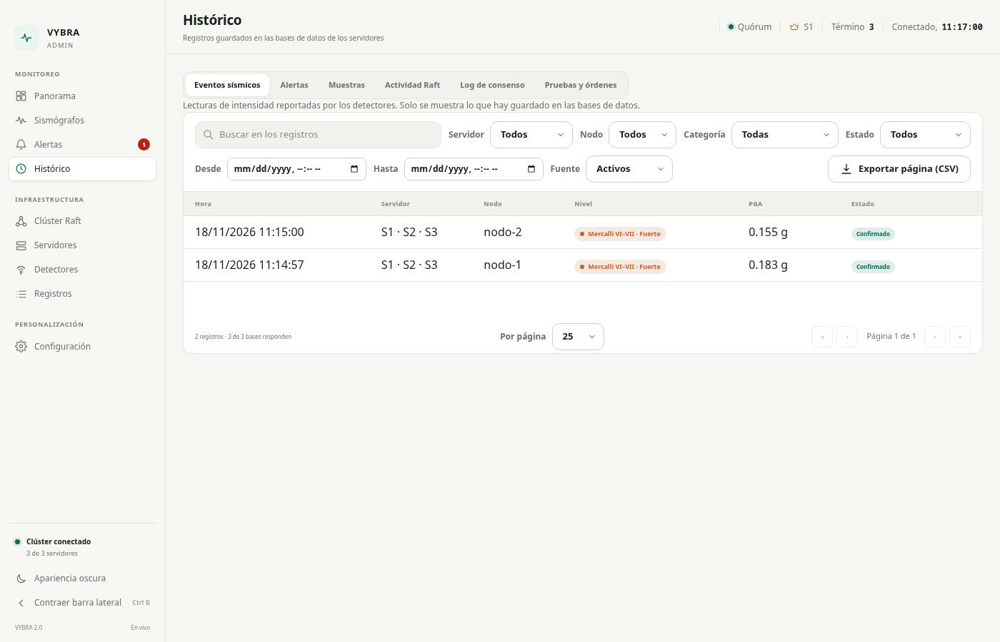

*Figura 15.1. Panel ADMIN, sección Histórico. Fuente: captura del stack real, `entrega/04-evidencias/B-interfaz/cap-REF-OP-04-historico.png`.*

### 15.5 Campaña física

La fase P0 se completó el 2026-11-17 con evidencias: las tres placas resolvieron por mDNS, respondieron a la identificación y a la API HTTP, y se tomaron instantáneas previas del estado del clúster. La Figura 15.2 muestra el panel con el clúster físico antes de la prueba T1.


*Figura 15.2. Panel con las tres placas físicas en la fase P0. Fuente: `entrega/04-evidencias/F-fisicas/cap-FIS-00-panel.png`.*

La prueba T1 no se aprobó. Una pulsación produjo **dos eventos cortos** de 301 ms y 174 ms, separados por 3,2 segundos, en lugar de uno de ~900 ms. Los dos eventos tienen identificadores distintos e idénticos en los tres nodos, el log pasó de longitud 1 a 3 y el índice de confirmación acompañó el cambio; no se creó alerta, correctamente, porque intervino un solo detector. El nivel y el PGA coinciden con la fórmula para las duraciones medidas: el cálculo y el consenso funcionaron y la anomalía está en la entrada física. Las Figuras 15.3 y 15.4 muestran el panel antes y después de la pulsación.

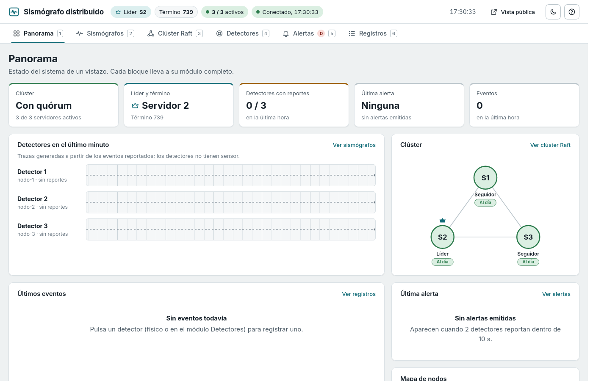

*Figura 15.3. Panel antes de T1. Fuente: `entrega/04-evidencias/F-fisicas/cap-FIS-01-panel-antes.png`.*

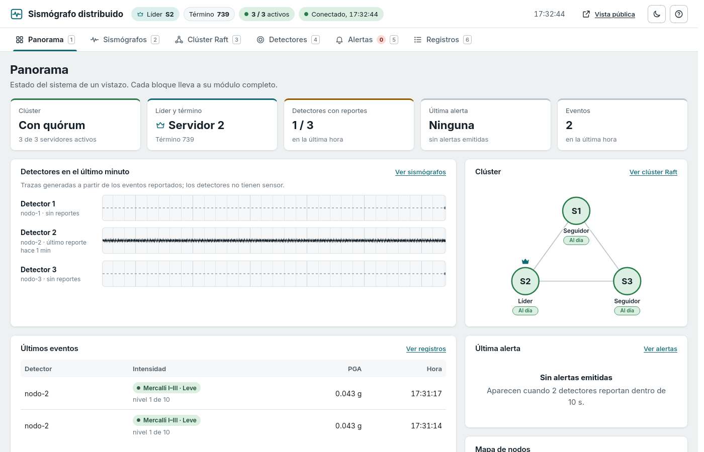

*Figura 15.4. Panel después de T1. Fuente: `entrega/04-evidencias/F-fisicas/cap-FIS-01-panel-despues.png`.*

El diagnóstico descarta el firmware: un contacto mantenido habría producido un solo evento y un rebote habría producido fragmentos separados por milisegundos, no por tres segundos. Las causas probables son el cableado o el pulsador, y la repetición queda pendiente de revisión del contactor; T2 en adelante espera autorización.

### 15.6 Trazabilidad objetivo a evidencia

La Tabla 15.3 enlaza los requisitos del apartado 4 con la evidencia que los respalda.

**Tabla 15.3.** Trazabilidad requisito, objetivo y evidencia.

| Requisito | Objetivo específico | Evidencia principal |
|---|---|---|
| RF-01, RF-02, RF-03 | 1 | `log-TST-01-cpp.txt` (32 casos de Raft), estado en vivo del stack |
| RF-04, RF-10 | 1, 2 | Casos de reenvío y caída en la suite C++, prueba de failover en `test:infra` |
| RF-05 | 1, 2 | Casos de recuperación, `test:infra` (recuperación tras apagado) |
| RF-06 | 3 | `test_sismo` (11 casos), prueba de dos detectores con hardware pendiente |
| RF-07 | 4, 5 | `test/server.test.js`, `test/poller.test.js`, capturas de ADMIN y CLIENTE |
| RF-08 | 6 | `test:db` (70 aprobados), captura del histórico y de `/api/estado` |
| RF-09 | 7 | `test:infra` (5 de 5), `test/controlador.test.js` |
| RNF-01 | 1, 7 | Escenario sin quórum en `test:infra` y en `test_raft` |
| RNF-02 | 2 | Tabla de tamaños de firmware, uso de RAM y flash |
| RNF-03 | 4, 5 | `test/server.test.js` (SSE y latido), captura de la interfaz |
| RNF-04 | 7, 9 | Despliegue Docker de 11 servicios, nodo simulado con Raft real |
| RNF-05 | 2, 7 | Controlador aislado, secretos fuera del repositorio, nota de saneado |
| RNF-06 | 9 | Inventario de evidencias, registros con fecha y comando |

### 15.7 Nota sobre cifras históricas

La versión declarada en `VERSION` conserva cifras de la fase de estabilización que no corresponden al estado actual. Las cifras vigentes son las re-ejecutadas el 2026-11-18 y consignadas aquí; `README.md` ya refleja los valores actuales.

## 16. Discusión

El sistema demuestra los mecanismos centrales de un servicio replicado. La suite C++ prueba que el núcleo elige líder, replica, confirma por mayoría, reenvía propuestas, recupera nodos y aplica la regla de alerta de forma determinista con el mismo código que corre en las placas. El despliegue Docker demuestra que ese núcleo, compilado para Linux, se comporta como un clúster real: los contenedores se eligen entre sí, detectan caídas y recuperan el quórum.

La comparación con Raft revela las distancias. La implementación respeta las reglas de seguridad, pero se aparta en la durabilidad: el log vive en RAM y la resincronización de emergencia puede descartar entradas confirmadas cuando una mayoría se reinicia en frío. Esa decisión mantiene la convergencia y evita un estado divergente permanente, pero no ofrece la garantía de durabilidad de un Raft con log persistente: defendible en un prototipo académico, inaceptable en una red de alerta real.

El quórum que muestra el agregador es una inferencia, no una prueba. El panel lo declara cuando dos nodos disponibles reconocen al mismo líder; esa condición es necesaria pero no suficiente, porque entre la respuesta y la publicación de la fotografía el líder puede haber caído. La interfaz debe leerse como indicador operativo y no como garantía formal. Como no hay pre-voto ni comprobación de quórum, un líder aislado puede seguir creyéndose líder hasta que otro nodo lo desmienta.

La incidencia de T1 ilustra el valor de la evidencia. El sistema replicó y confirmó dos entradas con identificadores consistentes, no generó alerta con un solo detector y calculó niveles y PGA coherentes con las duraciones medidas. Esos hechos localizan la anomalía en la entrada física y descartan el consenso y el cálculo. La campaña sigue en curso y la versión definitiva no se etiqueta hasta completarla.

El alcance excluye la medición sísmica, lo que limita las conclusiones: no puede afirmarse nada sobre detección real, calibración de umbrales ni comportamiento ante un sismo verdadero. Sí puede afirmarse que la arquitectura distribuida funciona con entradas sintéticas y que el camino crítico —propuesta, replicación, confirmación, aplicación y alerta— está implementado y probado.

## 17. Limitaciones y trabajo futuro

La Tabla 17.1 recoge las limitaciones vigentes, verificadas en el código y en el `README.md`.

**Tabla 17.1.** Limitaciones del sistema.

| # | Limitación | Consecuencia |
|---|---|---|
| 1 | El evento es simulado con un pulsador; no hay medición sísmica | No se puede evaluar detección real ni calibración |
| 2 | El log de Raft no es durable (RAM) | Un corte puede perder entradas aceptadas y no confirmadas |
| 3 | Resincronización de emergencia | Un nodo puede descartar su log y copiarlo del líder |
| 4 | Sin snapshots | Tope de 1.000 entradas; al llenarse se rechazan eventos nuevos |
| 5 | Sin seguridad de transporte | HTTP y UDP sin autenticación ni cifrado; CORS abierto |
| 6 | Sin pre-voto ni comprobación de quórum | Un líder aislado sigue creyéndose líder |
| 7 | Acuse de reenvío al aceptar, no al confirmar | Un evento puede perderse si el líder muere justo después |
| 8 | El quórum del agregador es una inferencia | La interfaz no garantiza consenso en el instante mostrado |
| 9 | Panel sin autenticación | Cualquiera en la red puede ordenar apagados o pulsaciones |

El trabajo futuro se ordena en tres frentes: durabilidad —persistir el log, implementar snapshots y compactación y recuperar sin descartar lo confirmado—; seguridad —autenticación de mensajes Raft, TLS, control de acceso y rotación de secretos—; y observabilidad —métricas de latencia de commit, elección y recuperación, y avisos cuando el log se llena o se pierde el quórum—. Se suman el cambio de membresía, la comprobación de quórum con pre-voto y, en el plano académico, la sustitución del pulsador por un acelerómetro.

## 18. Conclusiones

Se construyó un sistema distribuido académico de detección sísmica simulada sobre tres ESP32 con consenso Raft propio, agregación en Node.js, tres bases PostgreSQL, panel ADMIN, vista CLIENTE y controlador de infraestructura. Implementa elección de líder, replicación de un log, confirmación por mayoría, reenvío de propuestas, recuperación de nodos y una máquina de estados determinista que emite alertas cuando dos detectores coinciden en diez segundos.

La validación re-ejecutada el 2026-11-18 lo confirma: 78 casos C++ aprobados, 75 casos JavaScript de los cuales 70 se ejecutan con bases reales, 5 pruebas de integración Docker aprobadas y compilación correcta del firmware para los tres nodos. El despliegue de once servicios se mantiene estable y ejecuta el mismo núcleo Raft compilado para Linux, lo que permite demostrar el sistema sin las placas. La campaña física está en curso: P0 se completó y T1 no se aprobó por una anomalía en la entrada física, aunque el sistema replicó, confirmó y calculó correctamente. T2 en adelante y la etiqueta definitiva quedan pendientes; las limitaciones se documentan para que el alcance del prototipo no se confunda con el de un sistema de alerta en producción.

La campaña física está en curso. La preparación P0 se completó con evidencias y la prueba T1 no se aprobó por una anomalía en la entrada física que produjo dos eventos cortos en lugar de uno; el sistema replicó, confirmó y calculó correctamente en ese escenario. Las pruebas T2 en adelante y la etiqueta definitiva de la versión quedan pendientes. Las limitaciones se documentan de forma explícita para que el alcance del prototipo no se confunda con el de un sistema de alerta en producción.

## 19. Bibliografía y anexos

### 19.1 Bibliografía

1. Ongaro, D. y Ousterhout, J. (2014). *In Search of an Understandable Consensus Algorithm (Extended Version)*. USENIX Annual Technical Conference. Disponible en https://raft.github.io/raft.pdf (consultado el 2026-11-18).
2. Lamport, L. (1978). *Time, Clocks, and the Ordering of Events in a Distributed System*. Communications of the ACM, 21(7), 558-565.
3. Schneider, F. B. (1990). *Implementing Fault-Tolerant Services Using the State Machine Approach: A Tutorial*. ACM Computing Surveys, 22(4), 299-319.
4. Espressif Systems. *Arduino core for the ESP32 — documentación oficial*. https://docs.espressif.com/projects/arduino-esp32/en/latest/ (consultado el 2026-11-18).
5. Espressif Systems. *ESP32 Technical Reference Manual*. https://www.espressif.com/documentation/esp32_technical_reference_manual_en.pdf (consultado el 2026-11-18).
6. Blanchon, B. *ArduinoJson — documentación oficial*. https://arduinojson.org/ (consultado el 2026-11-18).
7. OpenJS Foundation. *Node.js Documentation, versión 22 LTS*. https://nodejs.org/docs/latest-v22.x/api/ (consultado el 2026-11-18).
8. The PostgreSQL Global Development Group. *PostgreSQL 16 Documentation*. https://www.postgresql.org/docs/16/ (consultado el 2026-11-18).
9. WHATWG. *HTML Living Standard — Server-sent events*. https://html.spec.whatwg.org/multipage/server-sent-events.html (consultado el 2026-11-18).
10. Docker Inc. *Docker Documentation*. https://docs.docker.com/ (consultado el 2026-11-18).
11. Open Source Initiative. *The MIT License*. https://opensource.org/license/mit (consultado el 2026-11-18).

La licencia del proyecto es MIT, con copyright de Sebastián Revelo (2026). Las dependencias principales conservan sus licencias y se documentan en `THIRD-PARTY.md`: ArduinoJson (MIT), core ESP32 (LGPL-2.1), Node.js (MIT), las imágenes base y la tipografía Inter (SIL Open Font License 1.1). Además, **Leaflet 1.9.4** (licencia BSD-2-Clause) está vendorizado en `web/public/cliente/vendor/leaflet/` para el mapa del CLIENTE y se documenta en esta entrega (`02-codigo/README.md` y `09-anexos/referencias.md` §5); el `THIRD-PARTY.md` de la raíz aún no lo lista (discrepancia documentada).

### 19.2 Anexo A. Evidencias citadas

| Evidencia | Contenido |
|---|---|
| `entrega/04-evidencias/E-pruebas/` | Registros de las suites C++ y JavaScript |
| `entrega/04-evidencias/I-resultados/` | Tablas de tamaños de firmware y de pruebas |
| `entrega/04-evidencias/H-infraestructura/` | Estado de contenedores, sistemas operativos, registros y consumo |
| `entrega/04-evidencias/B-interfaz/` | Capturas de ADMIN, CLIENTE y vista móvil |
| `entrega/04-evidencias/D-nodos/` | Registros de flasheo, arranque, red y estado de las placas |
| `entrega/04-evidencias/F-fisicas/` | Capturas reales de la fase P0 y de la prueba T1 |
| `entrega/03-diagramas/exportado/` | Diagramas D-01 a D-14 en SVG y PNG |

### 19.3 Anexo B. Reproducción

```bash
# Despliegue completo con once servicios
docker compose up -d --build            # panel: http://127.0.0.1:8095/

# Pruebas del núcleo C++
mkdir -p /tmp/vybra && cp -a firmware/test /tmp/vybra/test
mkdir -p /tmp/vybra/detector && cp -a firmware/detector/src /tmp/vybra/detector/src
cd /tmp/vybra/test && make JSON_DIR="$HOME/Arduino/libraries/ArduinoJson/src" test

# Pruebas JavaScript y de integración
cd web && npm test
cd web && npm run test:db
cd web && npm run test:infra

# Compilación del firmware
arduino-cli compile --fqbn esp32:esp32:esp32 \
  --build-property "compiler.cpp.extra_flags=-DNODO=1" \
  --build-path /tmp/fw1 firmware/detector
```

### 19.4 Anexo C. Nota de alcance y saneado

Las evidencias de `entrega/` se sanearon para no exponer identificadores de red, direcciones ni credenciales; la sustitución se documenta en la nota de saneado y los resultados no se alteraron. El material de diseño histórico, los planes internos y las previsualizaciones de versiones anteriores no forman parte del repositorio ni de esta entrega. El evento es siempre simulado y así se declara en el firmware, en las interfaces y en este documento.
